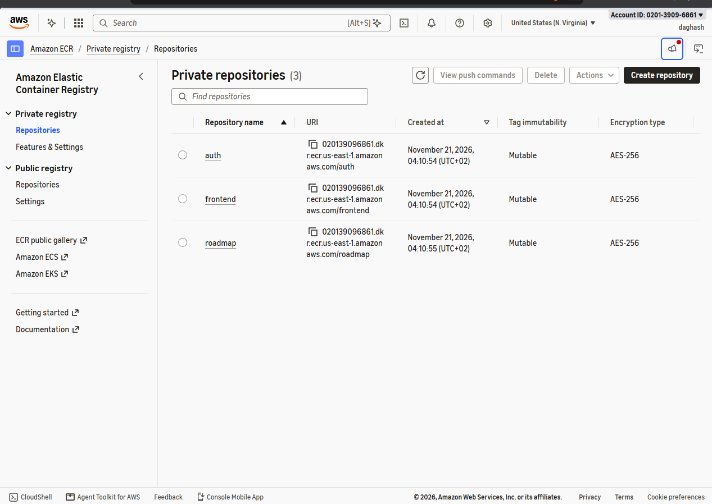
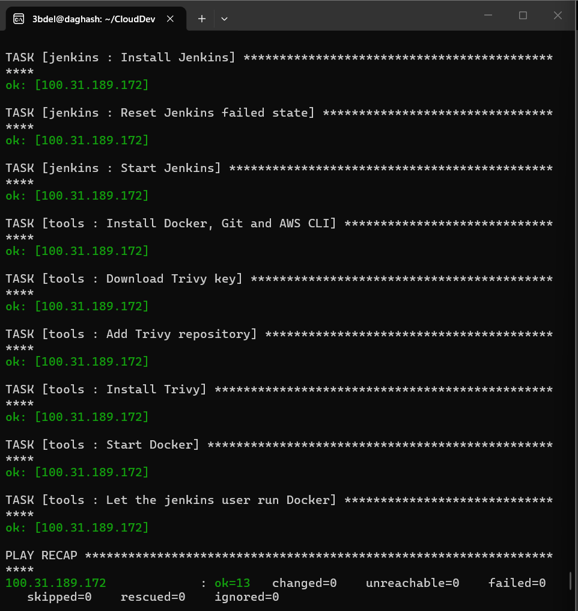
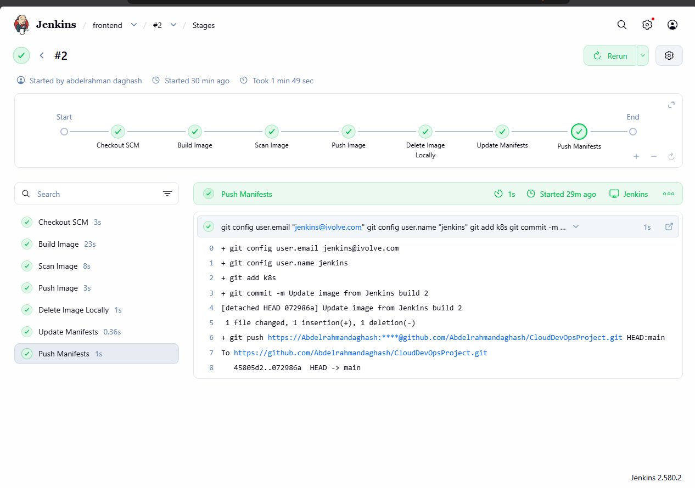
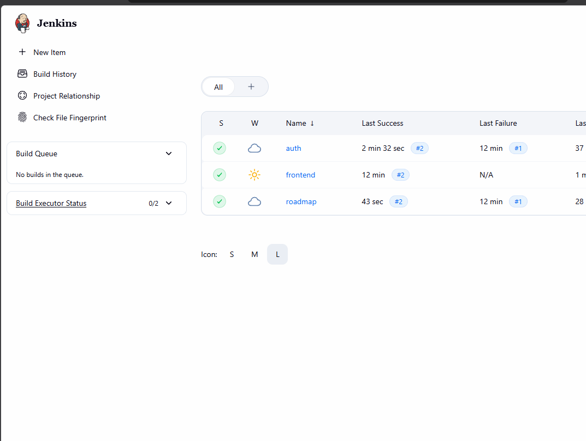
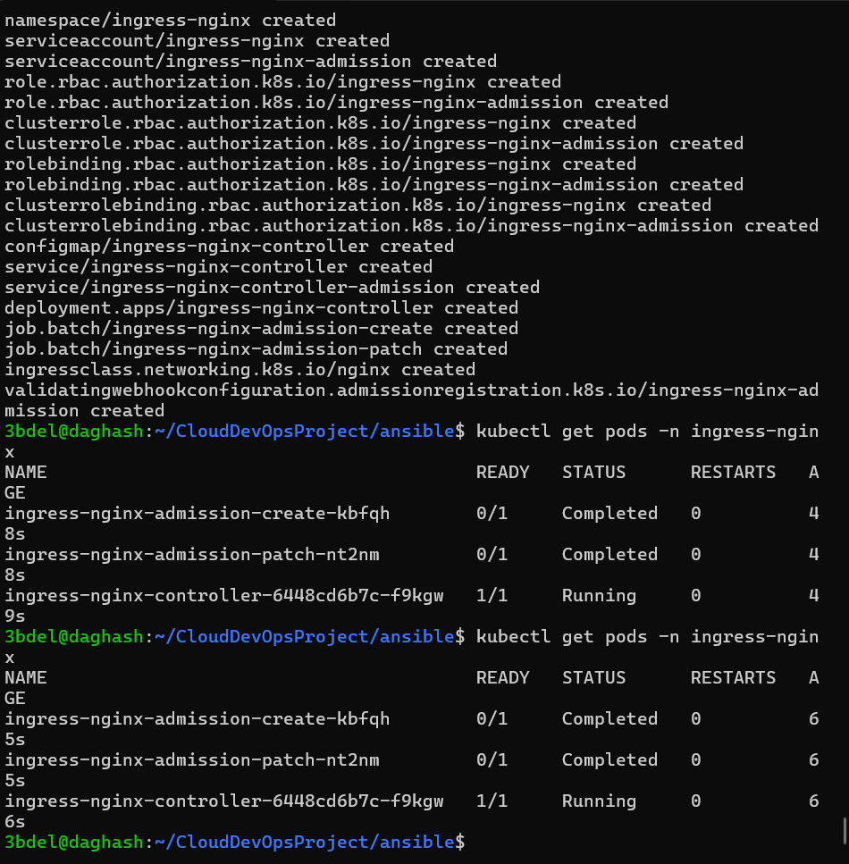
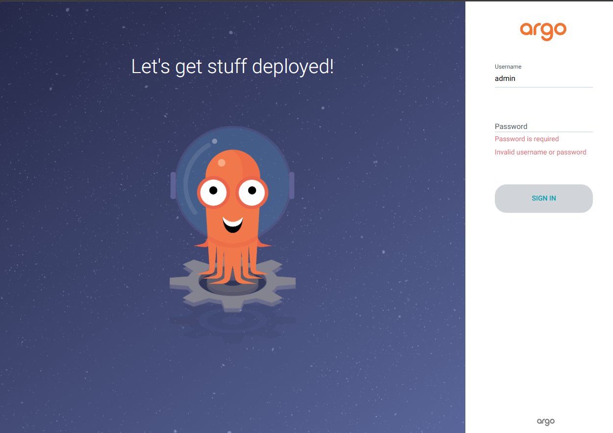
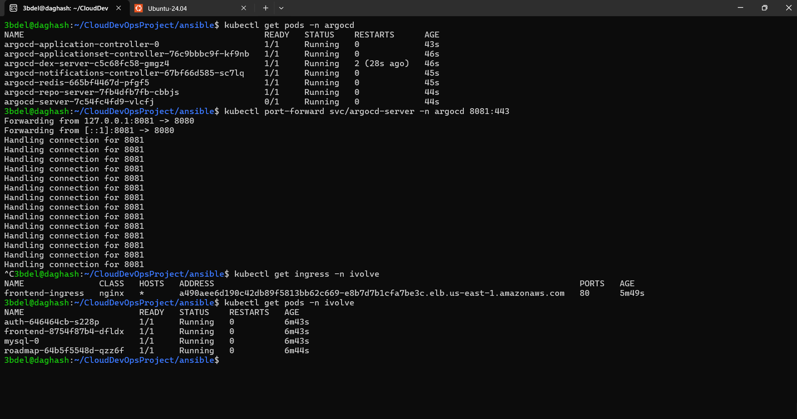
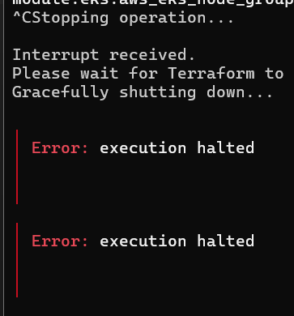
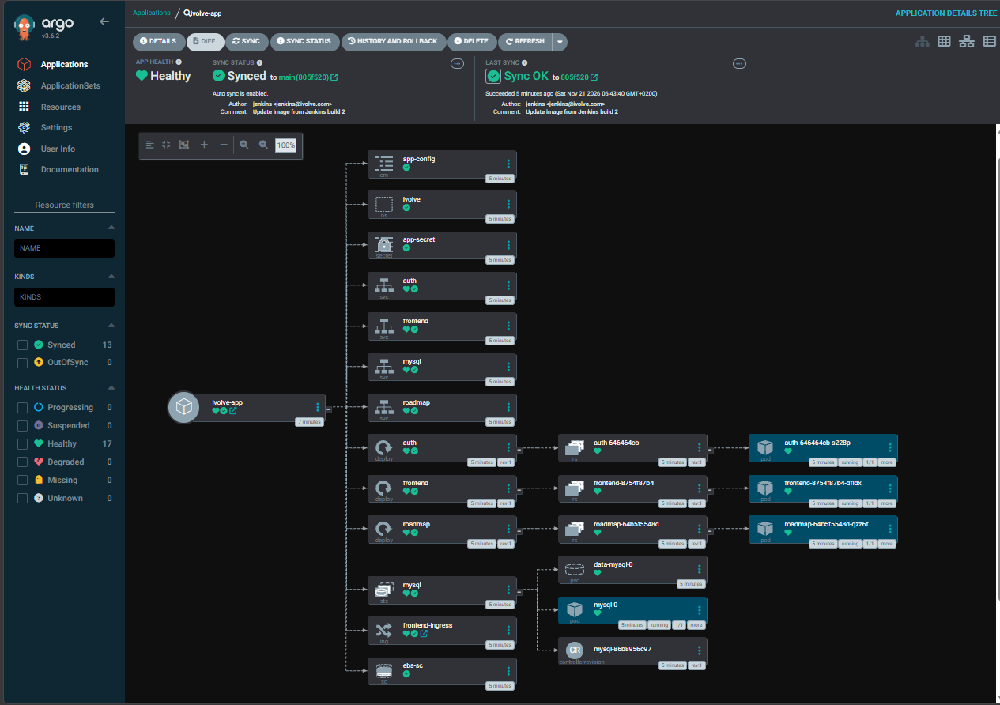

# CloudDevOpsProject — iVolve on EKS

> **NTI Final Project** — a complete GitOps delivery pipeline for the iVolve training platform:
> **Docker** packages the app, **Terraform** builds the AWS cloud, **Ansible** configures the CI server,
> **Jenkins** builds & scans the images, and **ArgoCD** deploys them to **EKS** — automatically, on every push.


**Status:** deployed end-to-end and verified live — `terraform apply` → Ansible `failed=0` → 3 green Jenkins
pipelines → ArgoCD `Synced / Healthy` → app reachable through the ingress Load Balancer.


---

## Table of contents

1. [Architecture](#architecture)
2. [Tech stack](#tech-stack)
3. [NTI task coverage](#nti-final-project--task-coverage)
4. [Repository structure](#repository-structure)
5. [How the pipeline works](#how-the-pipeline-works)
6. [Evidence — the full walkthrough](#evidence--the-full-walkthrough)
7. [Run it locally (Docker Compose)](#run-it-locally-docker-compose)
8. [Deploy to AWS — full guide](#deploy-to-aws--full-guide)
9. [Troubleshooting — real failures we hit & fixed](#troubleshooting--real-failures-we-hit--fixed)
10. [Cleanup & destroy](#cleanup--destroy)
11. [Cost notes](#cost-notes)

---

## Architecture

```
 Developer ──push──> GitHub repo <───────────────┐
                         │                        │ 4. Jenkins pushes the new
                         │ 1. Jenkins pipeline    │    image tag into k8s/ files
                         ▼                        │
    ┌──────────── Jenkins (EC2 t3.small) ────────┘
    │  Checkout → Build → Trivy scan → Push → Delete local image
    │                      │
    │                      ▼ 2. image stored in
    │                 AWS ECR (frontend, auth, roadmap)
    │
    └─ 3. ArgoCD (inside EKS) watches the k8s/ folder in GitHub
                 │ and syncs any change automatically
                 ▼
    ┌────────────── AWS VPC (2 public + 2 private subnets) ──┐
    │ Public subnets : Jenkins EC2, NAT GW, Load Balancer    │
    │ Private subnets: EKS worker node 1 (AZ-a)              │
    │                  EKS worker node 2 (AZ-b)              │
    │   namespace "ivolve":                                  │
    │     Ingress (nginx) → frontend → auth → MySQL          │
    │                        └──────→ roadmap                │
    │                                    (StatefulSet + EBS) │
    └────────────────────────────────────────────────────────┘
```

**The 3 microservices**

| Service | Technology | Port | Responsibility |
|---------|-----------|------|----------------|
| `frontend` | Node.js / Express | 3000 | UI, calls the two services below |
| `auth` | Python / Flask | 5000 | signup / login — the only service using MySQL |
| `roadmap` | Java / Spring Boot | 8080 | serves the DevOps roadmap data |
| `mysql` | MySQL 8 (StatefulSet) | 3306 | database on an EBS PVC (`ebs-sc` StorageClass) |

---

## Tech stack

| Tool | What it does in this project |
|------|------------------------------|
| **Docker / docker-compose** | Packages each service; runs the whole app + database on your laptop |
| **Terraform** | Creates the VPC, Jenkins EC2, EKS cluster (2 nodes / 2 AZs), ECR repos, EBS-CSI IRSA — state in S3 |
| **Ansible** | Configures the Jenkins server from scratch: Java, Jenkins, Docker, Trivy (dynamic AWS inventory) |
| **Kubernetes (EKS)** | Runs the frontend, auth, roadmap and MySQL in the `ivolve` namespace |
| **Jenkins** | 3 pipelines: build → Trivy scan → push to ECR → update manifests → push to GitHub |
| **ArgoCD** | GitOps: watches `k8s/` in GitHub and syncs the cluster automatically |
| **Trivy** | Vulnerability scan of every image before it is pushed |
| **ingress-nginx** | Exposes the app through one AWS Load Balancer |

---

## NTI Final Project — task coverage

| # | PDF requirement | Where it lives in this repo | Evidence |
|---|----------------|----------------------------|----------|
| **1** | GitHub repository with README, link delivered | this repository + [`README.md`](README.md) | the repo itself |
| **2** | Docker Compose builds & tests the app + DB locally | [`docker-compose.yml`](docker-compose.yml) + [`app/`](app/) | [Run locally](#run-it-locally-docker-compose) |
| **3** | Terraform: network, server, EKS (2 nodes / 2 AZs), ECR, S3 backend | [`terraform/`](terraform/) — modules `network`, `server`, `eks`, `ecr` + `backend.tf` | [`01`](Screenshots/01-terraform-apply-complete.png) [`03`](Screenshots/03-ecr-repositories.png) [`04`](Screenshots/04-eks-nodes-ready.png) |
| **4** | Ansible: roles + dynamic inventory for the Jenkins EC2 | [`ansible/`](ansible/) — roles `java`, `jenkins`, `tools` + `aws_ec2.yml` | [`02`](Screenshots/02-ansible-playbook-success.png) |
| **5** | K8s: namespace, Deployments, Services, StatefulSet, headless Service, StorageClass, ConfigMap, Secret, Ingress | [`k8s/`](k8s/) — 13 YAML files | [`05`](Screenshots/05-ingress-nginx-running.png) [`12`](Screenshots/12-ingress-elb-and-pods.png) |
| **6** | Jenkins: pipeline per service, multi-stage, shared library | [`jenkins/*/Jenkinsfile`](jenkins/) + [`vars/`](vars/) | [`06`](Screenshots/06-jenkins-jobs-all-green.png) [`07`](Screenshots/07-pipeline-frontend.png) [`08`](Screenshots/08-pipeline-auth.png) [`09`](Screenshots/09-pipeline-roadmap.png) |
| **7** | ArgoCD syncs & deploys the app | [`argocd/application.yaml`](argocd/application.yaml) | [`10`](Screenshots/10-argocd-install.png) [`11`](Screenshots/11-argocd-application-healthy.png) |
| **8** | Documentation: setup + architecture | this README + [`Screenshots/`](Screenshots/) gallery | [`13`](Screenshots/13-app-login-page.png) [`14`](Screenshots/14-troubleshooting-gpg-failure.png) [`15`](Screenshots/15-troubleshooting-free-tier-error.png) |

> Full screenshot gallery: [`Screenshots/`](Screenshots/) — 15 numbered evidence images, referenced step by step below.

---

## Repository structure

```
CloudDevOpsProject/
├── app/                  application source code
│   ├── frontend/         Node.js / Express  (port 3000)
│   ├── auth-service/     Python / Flask     (port 5000)
│   └── roadmap-service/  Java / Spring Boot (port 8080)
├── docker-compose.yml    local run: MySQL + auth + roadmap + frontend
├── terraform/            modules: network, server, eks, ecr  (+ S3 backend)
├── ansible/              dynamic inventory (aws_ec2.yml), playbook, roles: java, jenkins, tools
├── k8s/                  all 13 Kubernetes YAML files
├── jenkins/              Jenkinsfile for frontend, auth and roadmap
├── vars/                 Jenkins shared library (buildImage, scanImage, pushImage, …)
├── argocd/               ArgoCD Application manifest
├── Screenshots/          numbered evidence gallery (01 … 15)
└── README.md             this file
```

---

## How the pipeline works

1. You push to GitHub — or click **Build Now** in Jenkins.
2. Jenkins runs the service's pipeline: **Checkout → Build image → Trivy scan → Push to ECR → Delete local image → Update manifests → Push manifests**.
3. Jenkins rewrites the image tag inside `k8s/<service>-deployment.yaml` and commits it back to GitHub.
4. ArgoCD notices the change in GitHub and rolls the new pods out in the cluster — no human touching `kubectl`.

---

## Evidence — the full walkthrough

### 1 · Infrastructure as Code — Terraform (Task 3)

```bash
cd terraform
terraform init
terraform apply -var key_name=ivolve-key
```

**`Apply complete! Resources: 36 added, 0 changed, 0 destroyed.`** — VPC + subnets, Jenkins EC2,
EKS cluster with 2 nodes across 2 AZs, EBS-CSI addon (IRSA), 3 ECR repositories, all outputs printed:


The three ECR repositories (`auth`, `frontend`, `roadmap`) created by the `ecr` module:



### 2 · Configuration Management — Ansible (Task 4)

```bash
cd ansible
ansible-inventory --graph        # dynamic AWS inventory finds the Jenkins EC2
ansible-playbook playbook.yml
```

Every task green, **`PLAY RECAP … ok=13  changed=…  unreachable=0  failed=0`** —
Java, Jenkins, Docker, Git, AWS CLI and Trivy installed and started:



### 3 · Continuous Integration — Jenkins (Task 6)

All three jobs build and go green:


Each pipeline runs the same 7 stages — here is every service, stage view complete:

**`frontend`**


**`auth`**



**`roadmap`**



### 4 · Kubernetes cluster (Task 5)

```bash
aws eks update-kubeconfig --name ivolve-cluster --region us-east-1
kubectl get nodes                      # 2 nodes Ready
kubectl apply -f https://raw.githubusercontent.com/kubernetes/ingress-nginx/controller-v1.11.2/deploy/static/provider/aws/deploy.yaml
```




### 5 · GitOps — ArgoCD (Task 7)

```bash
kubectl create namespace argocd
kubectl apply -n argocd -f https://raw.githubusercontent.com/argoproj/argo-cd/stable/manifests/install.yaml
kubectl apply -f argocd/application.yaml      # creates the "ivolve-app" application
```



The application reaches **`Healthy` + `Synced`** — every resource green, 13 Synced / 17 Healthy,
auto-sync enabled (last sync by `jenkins@ivolve.com`):



### 6 · The app is live

The ingress hands out an AWS Load Balancer address, and all 4 pods are `Running`:


Open that address in a browser — the iVolve login page, served from EKS:


Log in and the full roadmap appears. **End-to-end: `git push` → browser.** 🎉

---

## Run it locally (Docker Compose)

**Requirements:** Git, Docker (+ docker-compose).

```bash
docker compose up --build
```

This starts MySQL, `auth-service`, `roadmap-service` and `frontend` with one command —
exactly what Task 2 asks for: the app **and** its database, buildable and testable offline.

Open **http://localhost** (frontend), stop with `docker compose down`, wipe data with `docker compose down -v`.

---

## Deploy to AWS — full guide

**Requirements (on your machine / WSL):** Git, Docker, Terraform, Ansible
(`pip install boto3`, `ansible-galaxy collection install amazon.aws`), AWS CLI (`aws configure`), kubectl.

> This project was built and verified entirely inside **WSL (Ubuntu 24.04)**.

### Step 1 — GitHub repository

1. Create a repository named **CloudDevOpsProject** and clone it.
2. Copy this project in, then put the iVolve source into `app/` (`frontend`, `auth-service`, `roadmap-service`).
3. `git add . && git commit -m "first commit" && git push`.

### Step 2 — Run locally first

```bash
docker compose up --build     # verify everything works before touching AWS
```

### Step 3 — AWS infrastructure (Terraform) — *Task 3*

1. Create an **S3 bucket** for the state file and an **EC2 key pair** (e.g. `ivolve-key`), download the `.pem`.
2. Put the bucket name in `terraform/backend.tf`.
3. Replace the placeholders `020139096861` (your AWS account) and `Abdelrahmandaghash` (your GitHub user)
   in `k8s/*-deployment.yaml`, `jenkins/*/Jenkinsfile` and `argocd/application.yaml`, then push.
4. Apply:

```bash
cd terraform
terraform init
terraform apply -var key_name=ivolve-key
```

Takes ~15 minutes. Note the outputs: **`jenkins_public_ip`**, **`ecr_urls`**, **`eks_cluster_name`**.

> ⚠️ On a **free-tier account every instance type must be `t3.small`** — see
> [troubleshooting](#troubleshooting--real-failures-we-hit--fixed).

### Step 4 — Configure the Jenkins server (Ansible) — *Task 4*

1. Put your `.pem` path in `ansible/ansible.cfg` (default `~/ivolve-key.pem`).
2. Run:

```bash
cd ansible
ansible-inventory --graph      # dynamic inventory → the Jenkins EC2 by tag
ansible-playbook playbook.yml
```

3. Open `http://<jenkins_public_ip>:8080` and grab the initial password:

```bash
ssh -i ~/ivolve-key.pem ubuntu@<jenkins_public_ip> "sudo cat /var/lib/jenkins/secrets/initialAdminPassword"
```

### Step 5 — Connect to the cluster (Task 5)

```bash
aws eks update-kubeconfig --name ivolve-cluster --region us-east-1
kubectl get nodes        # expect 2 Ready
kubectl apply -f https://raw.githubusercontent.com/kubernetes/ingress-nginx/controller-v1.11.2/deploy/static/provider/aws/deploy.yaml
```

### Step 6 — Jenkins setup in the web UI (Task 6)

1. **Install suggested plugins** (Git, Pipeline, Credentials Binding, Docker).
2. **Manage Jenkins → Credentials → Add "Username with password"** — ID must be exactly **`github-creds`**,
   values = your GitHub username + a Personal Access Token with **repo** scope.
3. **Manage Jenkins → System → Global Trusted Pipeline Libraries** — add a library named
   **`shared-lib`** (Git → this repo; the `vars/` folder is picked up automatically).
4. Create three **Pipeline** jobs — `frontend`, `auth`, `roadmap` — each
   *Pipeline script from SCM* → Git → this repo → Script Path:
   `jenkins/frontend/Jenkinsfile`, `jenkins/auth/Jenkinsfile`, `jenkins/roadmap/Jenkinsfile`.
5. **Build Now** on each — every stage should go green (see [evidence](#3--continuous-integration--jenkins-task-6)).

### Step 7 — ArgoCD (Task 7)

```bash
kubectl create namespace argocd
kubectl apply -n argocd -f https://raw.githubusercontent.com/argoproj/argo-cd/stable/manifests/install.yaml
kubectl apply -f argocd/application.yaml
```

ArgoCD now watches `k8s/` in GitHub and deploys into the `ivolve` namespace.

```bash
kubectl port-forward svc/argocd-server -n argocd 8081:443     # UI on https://localhost:8081
kubectl -n argocd get secret argocd-initial-admin-secret -o jsonpath="{.data.password}" | base64 -d
```

Username: `admin`.

### Step 8 — Open the app (Task 5 & 7)

```bash
kubectl get ingress -n ivolve
kubectl get pods -n ivolve      # expect auth, frontend, roadmap, mysql — all Running
```

Open the `ADDRESS` shown by the ingress in your browser. Done. ✅

---

## Troubleshooting — real failures we hit & fixed

### 1 · `InvalidParameterCombination: not eligible for Free Tier`



**Cause:** the config asked for `t3.medium`, which a free-tier account may not launch.
**Fix:** every instance type must be **`t3.small`**:

```bash
grep -rn "t3\." terraform/       # all hits must be t3.small
```

Ctrl+C out of the stuck apply, fix, re-run — it is safe (the node group keeps creating in the background
until you cancel, then a fresh apply finishes in ~15 min).

### 2 · Jenkins repo GPG: `NO_PUBKEY 7198F4B714ABFC68`



**Cause:** the 2023 Jenkins apt signing key **expired 2026-03-26**, so `apt update` rejects the repo.
**Fix:** use the current key — `jenkins.io-2026.key` (see `ansible/roles/jenkins/tasks/main.yml`),
downloaded with `force: yes` so re-runs refresh it.

### 3 · Jenkins won't start: systemd start rate-limit

**Cause:** several failed starts in a row latch systemd's `StartLimitBurst=5 / 5m`,
so even a fixed config gets `start request repeated too quickly`.
**Fix:** reset the latch before starting (already in the playbook):

```bash
sudo systemctl reset-failed jenkins && sudo systemctl start jenkins
```

### 4 · Jenkins fails with a Java error

**Cause:** current Jenkins packages require **Java 21**; older guides say Java 17.
**Fix:** `openjdk-21-jre` (see `ansible/roles/java/tasks/main.yml`).

### 5 · Build fails at `git push` / ECR auth

Credential ID must be **exactly** `github-creds` (lowercase, no spaces) and the PAT must have **repo**
scope and not be expired. For ECR, the `aws` CLI installed by Ansible + the instance role handle auth —
check `aws ecr get-login-password` works on the server.

---

## Cleanup & destroy

**Avoid AWS charges — destroy the same day you finish:**

```bash
kubectl delete ingress --all -n ivolve      # release the Load Balancer first
cd terraform
terraform destroy -var key_name=ivolve-key
```

The S3 state bucket and the EC2 key pair are kept (they are created outside Terraform) —
re-running `terraform apply` reuses them.

---

## Cost notes

Everything runs on **free-tier-eligible `t3.small`** instances:

| Resource | Notes |
|----------|-------|
| Jenkins EC2 `t3.small` | 1× public subnet |
| EKS control plane | ~$0.10/h |
| 2× `t3.small` worker nodes | private subnets, one per AZ |
| NAT Gateway + Load Balancer | hourly + data processing |
| EBS volumes, ECR, S3 | pennies |

**≈ $0.30–0.40 / hour** while up. Always `terraform destroy` when you are done.

---

*Built for the NTI Final Project · iVolve Technologies × National Telecommunication Institute*
