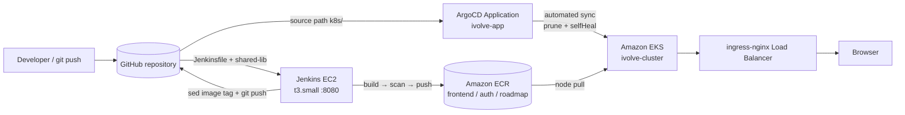
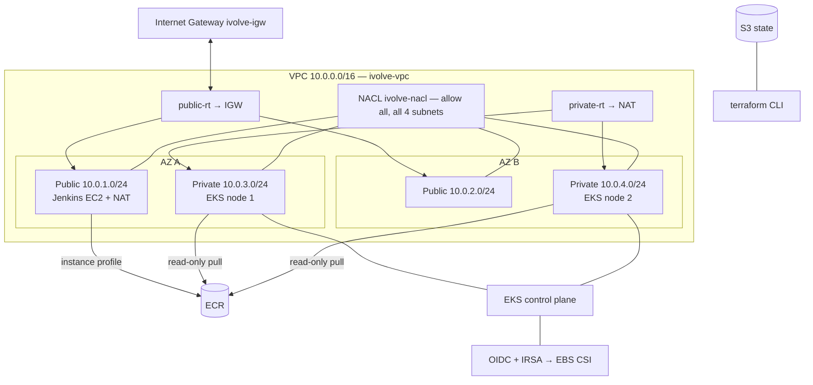
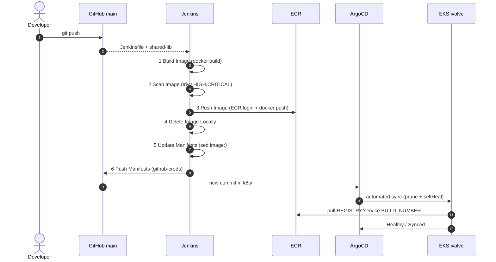
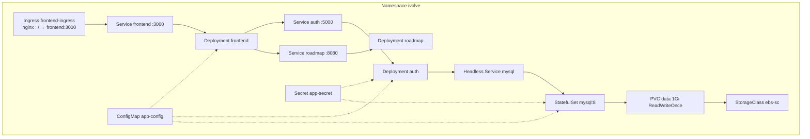
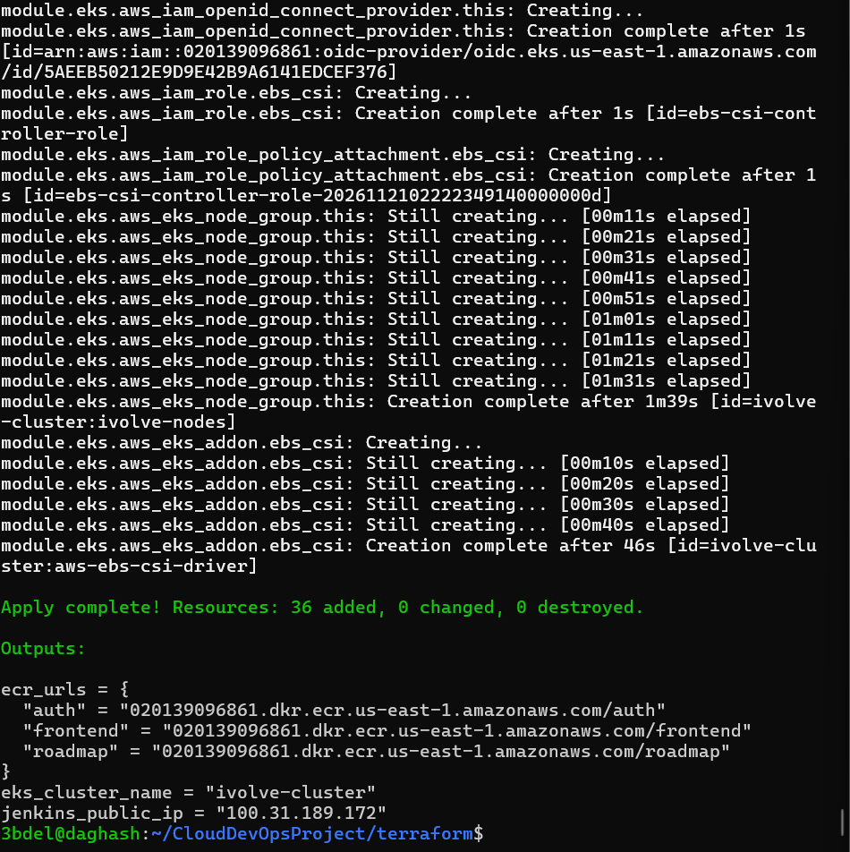
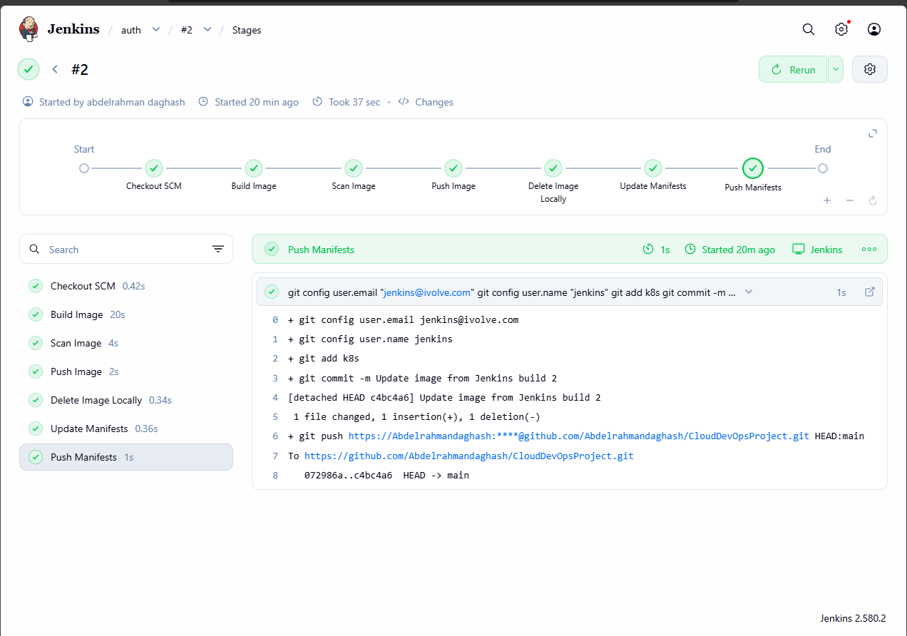
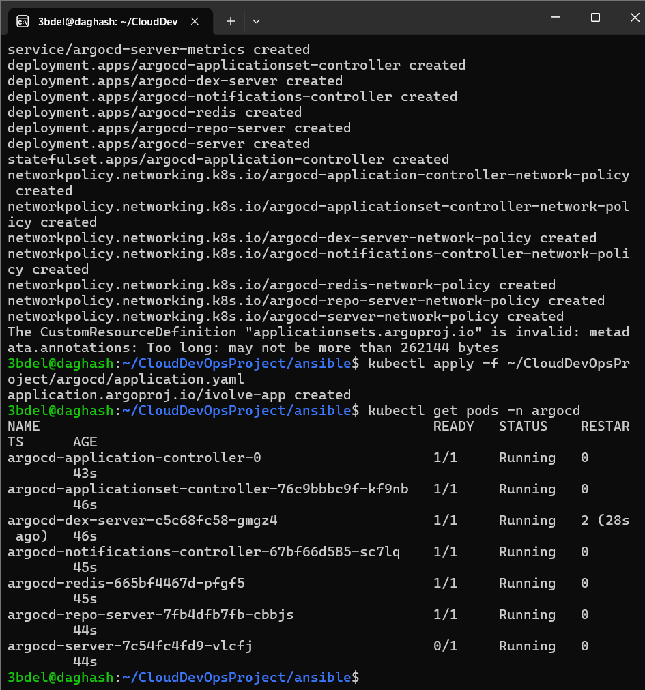

<a id="top"></a>

<div align="center">
  <h1>CloudDevOpsProject</h1>
  <p><strong>NTI Final Project — a complete, automated GitOps delivery pipeline for the iVolve training platform.</strong></p>
  <p>Docker packages the app · Terraform builds AWS · Ansible configures Jenkins · Jenkins builds, scans and publishes images · ArgoCD deploys to Amazon EKS.</p>
</div>

<p align="center">
  
  
  
  
  
  
  
  
</p>

**Repository:** https://github.com/Abdelrahmandaghash/CloudDevOpsProject
**Original application source:** https://github.com/IbrahimAdel15/iVolveFinalProject.git

---

## Contents

- [1. Project overview](#overview)
- [2. NTI task checklist](#task-checklist)
- [3. Architecture](#architecture)
- [4. Technology stack](#technology-stack)
- [5. Repository structure](#repository-structure)
- [6. Prerequisites](#prerequisites)
- [7. Step-by-step deployment guide](#step-by-step-deployment-guide)
  - [8.1 GitHub repository setup](#81-github-repository-setup)
  - [8.2 Docker — local container stack](#82-docker--local-container-stack)
  - [8.3 Terraform — AWS infrastructure](#83-terraform--aws-infrastructure)
  - [8.4 Ansible — configure the Jenkins server](#84-ansible--configure-the-jenkins-server)
  - [8.5 Kubernetes — manifests and exposure](#85-kubernetes--manifests-and-exposure)
  - [8.6 Jenkins CI — pipelines and shared library](#86-jenkins-ci--pipelines-and-shared-library)
  - [8.7 ArgoCD — GitOps delivery](#87-argocd--gitops-delivery)
- [9. End-to-end workflow](#end-to-end-workflow)
- [10. Verification and testing](#verification-and-testing)
- [11. Security considerations](#11-security-considerations)
- [12. Cost awareness and cleanup](#12-cost-awareness-and-cleanup)
- [13. Troubleshooting](#13-troubleshooting)
- [14. Challenges faced and lessons learned](#14-challenges-and-lessons-learned)
- [15. Future improvements](#15-future-improvements)
- [16. Project status and references](#16-project-status-and-references)

> **Deep-dive companion documents:** [Architecture](docs/architecture.md) ·
> [Troubleshooting](docs/troubleshooting.md) · [Docker Compose reference](docs/compose.md) ·
> [Screenshot manifest](docs/images/README.md)

---

<a id="overview"></a>
## 1. Project overview

### The problem

The iVolve training platform is made of three independent microservices plus MySQL. Delivering it
manually means repeating the same error-prone steps: build each image, scan it, push it, edit a
Deployment, apply manifests, and hope the cluster matches the repository. There is no audit trail,
no automatic rollback, and no reliable way for a reviewer to rebuild the environment.

### The solution

This project encodes the whole delivery process in code:

1. **Dockerfiles** make each service portable and immutable.
2. **`docker-compose.yml`** runs the complete stack locally with a health-gated MySQL start.
3. **Terraform** creates the AWS environment and stores its state in S3.
4. **Ansible** configures the Jenkins EC2 from a dynamic inventory based on an EC2 tag.
5. **Jenkins** runs the same six-stage pipeline for each service and writes the new image tag into
   the Kubernetes manifests in GitHub.
6. **ArgoCD** watches those manifests and syncs EKS automatically, with `prune` and `selfHeal`.

Git is therefore the single source of truth: a deployment is a commit, not a manual `kubectl apply`.

### Goals

| Goal | How it is met |
|---|---|
| Reproducible infrastructure | Terraform modules `network`, `server`, `eks`, `ecr` |
| Reproducible local setup | One `docker compose up --build` |
| Automated CI | Three Jenkinsfiles + `vars/` shared library |
| Security before deployment | Trivy `HIGH,CRITICAL` scan stage |
| Automated CD | ArgoCD `ivolve-app`, automated sync with prune/self-heal |
| Persistent data | MySQL StatefulSet + 1 Gi EBS PVC via `ebs-sc` |
| Reviewable documentation | This README, 39 folder READMEs and `docs/` |

### What the project delivers

- A live iVolve frontend exposed through an nginx Ingress on an AWS Load Balancer.
- Three private ECR repositories with build-number-tagged images.
- An EKS cluster with 2 `t3.small` worker nodes across two availability zones.
- A Jenkins CI server provisioned entirely by Ansible.
- A GitOps loop from `git push` to a healthy cluster without manual cluster access.
- 16 numbered evidence captures in [`Screenshots/`](Screenshots/README.md).

---

<a id="task-checklist"></a>
## 2. NTI task checklist

| # | Official task | Deliverable | Folder / file that satisfies it | Status |
|---:|---|---|---|---|
| 1 | GitHub repository with README and delivered link | Public repo, root documentation | [`README.md`](README.md), repo URL above | ✅ Completed |
| 2 | Docker: build and test app + database locally | Four-service Compose stack | [`docker-compose.yml`](docker-compose.yml), [`app/`](app/README.md), [`docs/compose.md`](docs/compose.md) | ✅ Completed |
| 3 | Terraform: network, server, EKS (2 nodes / 2 AZs), ECR, S3 backend | 36 AWS resources from code | [`terraform/`](terraform/README.md) + [4 modules](terraform/modules/README.md) | ✅ Completed |
| 4 | Ansible: roles + dynamic inventory for the Jenkins EC2 | Dynamic inventory + 3 roles | [`ansible/`](ansible/README.md), [`ansible/roles/`](ansible/roles/README.md) | ✅ Completed |
| 5 | Kubernetes: namespace, Deployments, Services, StatefulSet, headless Service, StorageClass, ConfigMap, Secret, Ingress | 13 manifests | [`k8s/`](k8s/README.md) | ✅ Completed |
| 6 | Jenkins CI: one pipeline per service, shared library | 3 Jenkinsfiles + 6 Groovy steps | [`jenkins/`](jenkins/README.md), [`vars/`](vars/README.md) | ✅ Completed |
| 7 | ArgoCD CD: sync and deploy the app | `ivolve-app` Application | [`argocd/application.yaml`](argocd/application.yaml) | ✅ Completed |
| 8 | Documentation: setup + architecture | This documentation set | [`README.md`](README.md), [`docs/`](docs/architecture.md), per-folder READMEs | ✅ Completed |

> `TODO: add the exact grading rubric wording for each task if your coordinator requires it verbatim.`

---

<a id="architecture"></a>
## 3. Architecture

The complete component-by-component analysis lives in [docs/architecture.md](docs/architecture.md).
The four diagrams below are the executive view.

### 3.1 High-level system



### 3.2 AWS network



### 3.3 CI/CD sequence



### 3.4 Kubernetes workloads



### 3.5 Why each component was chosen

| Component | Why |
|---|---|
| Multi-stage Dockerfile for Java | Maven builds in `maven:3.9.11-eclipse-temurin-21`; runtime is only `eclipse-temurin:21-jre` |
| Compose healthcheck | `auth-service` waits for MySQL instead of racing it |
| S3 Terraform backend | Shared, versioned state; the bucket is created outside Terraform |
| Modules | Clear inputs/outputs make `main.tf` a readable blueprint |
| Private subnets for EKS | Nodes are not internet-addressable; NAT covers outbound pulls |
| IRSA for EBS CSI | Pods cannot use the node IAM role; the controller assumes a role via OIDC |
| Ansible dynamic inventory | Jenkins EC2 public IP changes after every `apply` |
| Shared library | Six stages defined once, used by three pipelines |
| ArgoCD instead of `kubectl apply` in Jenkins | Jenkins needs no cluster credentials; every deployment is a Git commit |


---

<a id="technology-stack"></a>
## 4. Technology stack

Only versions that appear in repository files are stated as facts; everything else is marked `TODO`.

| Layer | Technology | Version / source in this repository |
|---|---|---|
| Container runtime | Docker, Docker Compose | Used via `docker compose`; `TODO: record installed Docker Engine and Compose versions` |
| Frontend base image | `node:22-alpine` | [`app/frontend/Dockerfile`](app/frontend/Dockerfile) |
| Frontend libraries | express `^5.1.0`, ejs `^3.1.10`, axios `^1.11.0`, express-session `^1.18.2` | [`app/frontend/package.json`](app/frontend/package.json) |
| Auth base image | `python:3.12-slim` | [`app/auth-service/Dockerfile`](app/auth-service/Dockerfile) |
| Auth libraries | Flask `3.1.1`, mysql-connector-python `9.4.0`, bcrypt `4.3.0` | [`app/auth-service/requirements.txt`](app/auth-service/requirements.txt) |
| Roadmap build image | `maven:3.9.11-eclipse-temurin-21` | [`app/roadmap-service/Dockerfile`](app/roadmap-service/Dockerfile) |
| Roadmap runtime image | `eclipse-temurin:21-jre` | [`app/roadmap-service/Dockerfile`](app/roadmap-service/Dockerfile) |
| Roadmap framework | Spring Boot `3.5.4`, Java `21` | [`app/roadmap-service/pom.xml`](app/roadmap-service/pom.xml) |
| Database | `mysql:8` | [`docker-compose.yml`](docker-compose.yml), [`k8s/mysql-statefulset.yaml`](k8s/mysql-statefulset.yaml) |
| Infrastructure | Terraform provider `hashicorp/aws ~> 5.0` | [`terraform/main.tf`](terraform/main.tf) |
| Locked providers | aws `5.100.0`, tls `4.4.2` | [`terraform/.terraform.lock.hcl`](terraform/.terraform.lock.hcl) |
| Terraform CLI | not pinned | `TODO: record the installed Terraform version` |
| Region | `us-east-1` | [`terraform/backend.tf`](terraform/backend.tf), [`terraform/variables.tf`](terraform/variables.tf) |
| Compute | EC2 `t3.small`, EKS node group `t3.small` (desired=min=max=2) | [`terraform/modules/server/variables.tf`](terraform/modules/server/variables.tf), [`terraform/modules/eks/main.tf`](terraform/modules/eks/main.tf) |
| Configuration management | Ansible, collection `amazon.aws` | [`ansible/aws_ec2.yml`](ansible/aws_ec2.yml); `TODO: record ansible and collection versions` |
| Java on Jenkins | `openjdk-21-jre` | [`ansible/roles/java/tasks/main.yml`](ansible/roles/java/tasks/main.yml) |
| Jenkins | installed from `pkg.jenkins.io/debian-stable` | [`ansible/roles/jenkins/tasks/main.yml`](ansible/roles/jenkins/tasks/main.yml); `TODO: record installed version` |
| Scanning | Trivy from `aquasecurity.github.io/trivy-repo/deb` | [`ansible/roles/tools/tasks/main.yml`](ansible/roles/tools/tasks/main.yml); `TODO: record installed version` |
| Ingress controller | `controller-v1.11.2` manifest | Step 6 command below |
| ArgoCD | `stable/manifests/install.yaml` | [`README.md` Step 8](#87-argocd--gitops-delivery); `TODO: record installed version` |
| kubectl / AWS CLI | used throughout, not pinned | `TODO: record installed versions` |

---

<a id="repository-structure"></a>
## 5. Repository structure

```text
CloudDevOpsProject/
├── .gitignore                       # ignores .terraform/, *.tfstate, *.pem, *.key, .aws/, credentials
├── README.md                        # this document
├── docker-compose.yml               # local full stack: db + auth + roadmap + frontend
│
├── app/                             # microservice source code
│   ├── README.md
│   ├── auth-service/                # Python 3.12 / Flask 3, port 5000
│   │   ├── Dockerfile
│   │   ├── app.py                   # /health, /api/auth/signup, /api/auth/login
│   │   ├── requirements.txt
│   │   └── README.md
│   ├── frontend/                    # Node.js 22 / Express 5 / EJS, port 3000
│   │   ├── Dockerfile
│   │   ├── package.json
│   │   ├── server.js                # routes, session, API proxying
│   │   ├── public/{css,images}/
│   │   ├── views/{auth,roadmap,error}.ejs
│   │   └── README.md
│   └── roadmap-service/             # Java 21 / Spring Boot 3.5.4, port 8080
│       ├── Dockerfile
│       ├── pom.xml
│       ├── src/main/java/com/ivolve/roadmap/
│       ├── src/main/resources/application.properties
│       └── README.md
│
├── terraform/                       # AWS infrastructure
│   ├── backend.tf                   # S3 backend
│   ├── main.tf                      # provider, AZ data source, 4 module calls
│   ├── outputs.tf                   # jenkins_public_ip, ecr_urls, eks_cluster_name
│   ├── variables.tf                 # region, key_name
│   ├── .terraform.lock.hcl
│   ├── modules/{network,server,eks,ecr}/
│   └── README.md
│
├── ansible/                         # Jenkins server configuration
│   ├── ansible.cfg                  # inventory, remote user, key path
│   ├── aws_ec2.yml                  # dynamic inventory plugin
│   ├── playbook.yml                 # java → jenkins → tools
│   ├── roles/{java,jenkins,tools}/
│   └── README.md
│
├── jenkins/                         # one pipeline per service
│   ├── {frontend,auth,roadmap}/Jenkinsfile
│   └── README.md
├── vars/                            # shared library: 6 Groovy steps
│   ├── buildImage.groovy
│   ├── scanImage.groovy
│   ├── pushImage.groovy
│   ├── deleteImage.groovy
│   ├── updateManifests.groovy
│   ├── pushManifests.groovy
│   └── README.md
│
├── k8s/                             # 13 Kubernetes manifests
│   ├── namespace.yaml, configmap.yaml, secret.yaml, storageclass.yaml
│   ├── mysql-headless-service.yaml, mysql-statefulset.yaml
│   ├── frontend-deployment.yaml, auth-deployment.yaml, roadmap-deployment.yaml
│   ├── frontend-service.yaml, auth-service.yaml, roadmap-service.yaml
│   ├── ingress.yaml
│   └── README.md
│
├── argocd/
│   ├── application.yaml             # ivolve-app, path k8s/, prune + selfHeal
│   └── README.md
│
├── Screenshots/                     # 16 numbered evidence captures + index
├── docs/
│   ├── architecture.md              # deep-dive diagrams and rationale
│   ├── troubleshooting.md           # 25 documented problems and fixes
│   ├── compose.md                   # Docker Compose folder-style reference
│   └── images/                      # screenshot library + capture manifest
└── (each folder above contains its own README.md)
```

> Note: the real filesystem also contains a Git metadata directory (`.git/`) and a local Terraform
> working directory (`.terraform/`) that is intentionally ignored by `.gitignore`; neither is part of
> the deliverable.

---

<a id="prerequisites"></a>
## 6. Prerequisites

Commands below were written for **Ubuntu on WSL 2**.

### 6.1 Tools

| Tool | Purpose | Check command |
|---|---|---|
| `git` | Clone and push | `git --version` |
| Docker + Compose | Build and run images locally | `docker --version && docker compose version` |
| Terraform | Create AWS infrastructure | `terraform version` |
| AWS CLI v2 | Configure credentials, ECR login, kubeconfig | `aws --version` |
| Python 3 + `boto3` | Ansible dynamic inventory | `python3 -c "import boto3; print(boto3.__version__)"` |
| Ansible + `amazon.aws` | Configure Jenkins EC2 | `ansible --version && ansible-galaxy collection list \| grep amazon.aws` |
| kubectl | Inspect the cluster | `kubectl version --client` |

```bash
sudo apt update
sudo apt install -y git curl unzip python3-pip
pip install boto3
ansible-galaxy collection install amazon.aws
# Install Docker, Terraform, kubectl and AWS CLI v2 from their official sources,
# then configure the AWS profile used by Terraform, Ansible and the CLI:
aws configure
aws sts get-caller-identity
```

> `TODO: pin the required minimum versions of Terraform, Ansible, kubectl, AWS CLI and Docker in this
> table once you record the versions you actually used.`

### 6.2 AWS permissions

The identity used by Terraform must be able to create and delete: VPC, subnets, Internet Gateway,
NAT Gateway, EIP, route tables, NACL, EC2 instances, security groups, IAM roles/policies/instance
profiles, OIDC providers, EKS cluster and node groups, EKS add-ons, and ECR repositories. It also
needs S3 read/write on the state bucket.

The identity used by Ansible needs at least `ec2:DescribeInstances` in `us-east-1`.

### 6.3 S3 state bucket and SSH key pair

The bucket name below is the one hard-coded in [`terraform/backend.tf`](terraform/backend.tf). Use a
**different, globally unique name** in your own account and update the file accordingly.

```bash
aws s3api create-bucket --bucket <STATE_BUCKET> --region us-east-1
aws s3api put-bucket-versioning --bucket <STATE_BUCKET> \
  --versioning-configuration Status=Enabled
aws s3api put-bucket-encryption --bucket <STATE_BUCKET> \
  --server-side-encryption-configuration \
  '{"Rules":[{"ApplyServerSideEncryptionByDefault":{"SSEAlgorithm":"AES256"}}]}'

aws ec2 create-key-pair --key-name <KEY_PAIR> \
  --query 'KeyMaterial' --output text > ~/ivolve-key.pem
chmod 400 ~/ivolve-key.pem
```

### 6.4 Credentials needed inside Jenkins

| Credential | Type / ID | Used by |
|---|---|---|
| GitHub PAT with `repo` scope | *Username with password*, ID exactly `github-creds` | `vars/pushManifests.groovy` |
| Shared library | Global Trusted Pipeline Library named `shared-lib`, Git, this repo, `main` | all three Jenkinsfiles |

> Never commit the PAT, the PEM file, the Terraform state, or the ArgoCD admin password. `.gitignore`
> already excludes `*.pem`, `*.key`, `*.csv`, `.aws/`, `credentials`, `*.tfstate` and `terraform/tfplan`.

---

<a id="step-by-step-deployment-guide"></a>
## 7. Step-by-step deployment guide

<a id="81-github-repository-setup"></a>
### 8.1 GitHub repository setup

**Purpose.** Create the single source of truth for application code, infrastructure code and the
desired Kubernetes state.

**What it creates.** One GitHub repository with a `main` branch containing every file in this tree.

**Files involved.** [`README.md`](README.md), [`.gitignore`](.gitignore), every folder README.

```bash
git clone https://github.com/<YOUR_USER>/CloudDevOpsProject.git
cd CloudDevOpsProject
git branch -M main
# copy the project files here, including the hidden .gitignore
git add .
git commit -m "Initial commit: full DevOps pipeline"
git push -u origin main
```

**Before you commit:** replace the example AWS account id, GitHub username, S3 bucket name and
repository URL in `terraform/backend.tf`, `k8s/*-deployment.yaml`, `jenkins/*/Jenkinsfile` and
`argocd/application.yaml`.

**Expected output.** `git status` clean; the repository shows the full tree on `main`.

**How to verify.** `git remote -v`, `git log --oneline -3`, open the repository URL.

**Common errors and fixes.**

| Symptom | Fix |
|---|---|
| `Permission denied (publickey)` | Use an HTTPS remote or add your SSH key to GitHub |
| Screenshots missing | Copy the 16 numbered PNGs from `Screenshots/`; do not re-add deleted images |

**Screenshot placeholder.** `docs/images/26-github-repository.png` — GitHub repository landing page
showing the folder list and README. See the [capture manifest](docs/images/README.md).

---

<a id="82-docker--local-container-stack"></a>
### 8.2 Docker — local container stack

**Purpose.** Prove the three microservices and MySQL work together before creating any AWS resource.
Full reference: [`docs/compose.md`](docs/compose.md).

**What it creates.** Four containers on Compose's default bridge network and one named volume
`db-data`.

**Files involved.**

| File | Key block |
|---|---|
| [`docker-compose.yml`](docker-compose.yml) | `db` uses `mysql:8`, healthcheck `mysqladmin ping` 5 s/5 s/20 retries; `auth-service` waits with `condition: service_healthy`; `frontend` maps host 80 → container 3000 |
| [`app/frontend/Dockerfile`](app/frontend/Dockerfile) | `node:22-alpine`, `npm install --omit=dev`, `EXPOSE 3000`, `CMD ["npm","start"]` |
| [`app/auth-service/Dockerfile`](app/auth-service/Dockerfile) | `python:3.12-slim`, `pip install -r requirements.txt`, `EXPOSE 5000`, `CMD ["python","app.py"]` |
| [`app/roadmap-service/Dockerfile`](app/roadmap-service/Dockerfile) | stage 1 `maven:3.9.11-eclipse-temurin-21` builds `roadmap-service-1.0.0.jar`; stage 2 `eclipse-temurin:21-jre` runs `java -jar app.jar` |

```bash
docker compose config          # read-only validation
docker compose up --build
docker compose ps
curl http://localhost:5000/health
curl http://localhost:8080/api/roadmap
curl http://localhost/
docker compose logs -f auth-service
docker compose down            # or: docker compose down -v (deletes DB volume)
```

**Expected output.** `db` is `healthy`; the login page renders with both logos; signup → login →
roadmap page shows eight cards; `/health` reports the database connected.

**How to verify.** See the [verification table](#10-verification-and-testing) and
[`docs/compose.md`](docs/compose.md).

**Common errors and fixes.**

| Symptom | Fix |
|---|---|
| Port 80 already allocated | Stop the other service or temporarily remap `80:3000` |
| `auth-service` 503 | Check all five `DB_*` variables and MySQL health |
| Maven build fails | `cd app/roadmap-service && mvn clean package -DskipTests` to see the real error |


---

<a id="83-terraform--aws-infrastructure"></a>
### 8.3 Terraform — AWS infrastructure

**Purpose.** Create the complete cloud environment declaratively.

**What it creates.** 36 resources: VPC `10.0.0.0/16`, 2 public + 2 private subnets in the first two
AZs, IGW, NAT, route tables, permissive NACL, Jenkins EC2, IAM roles, EKS cluster and 2-node group,
OIDC provider, IRSA role, EBS CSI add-on, and three ECR repositories.

**Files involved.**

| File | Key blocks |
|---|---|
| [`terraform/backend.tf`](terraform/backend.tf) | `backend "s3"` — bucket, key, region |
| [`terraform/main.tf`](terraform/main.tf) | provider `~> 5.0`; `data.aws_availability_zones`; modules `network`, `server`, `eks`, `ecr` |
| [`terraform/variables.tf`](terraform/variables.tf) | `region = us-east-1`, `key_name` required |
| [`terraform/outputs.tf`](terraform/outputs.tf) | `jenkins_public_ip`, `ecr_urls`, `eks_cluster_name` |
| [`terraform/modules/network/main.tf`](terraform/modules/network/main.tf) | subnet CIDRs `10.0.1.0/24`, `10.0.2.0/24`, `10.0.3.0/24`, `10.0.4.0/24`; ELB role tags |
| [`terraform/modules/server/main.tf`](terraform/modules/server/main.tf) | `jenkins-sg`, instance profile, `t3.small`, tag `Name=jenkins-server` |
| [`terraform/modules/eks/main.tf`](terraform/modules/eks/main.tf) | cluster role, node group, OIDC, IRSA, `aws-ebs-csi-driver` add-on |
| [`terraform/modules/ecr/main.tf`](terraform/modules/ecr/main.tf) | `for_each` over `["frontend","auth","roadmap"]`, `force_delete = true` |

**Module inputs.**

| Module | Input | Value |
|---|---|---|
| network | `vpc_cidr`, `azs`, `public_subnet_cidrs`, `private_subnet_cidrs` | `10.0.0.0/16`, first 2 AZs, `10.0.1/10.0.2`, `10.0.3/10.0.4` |
| server | `vpc_id`, `subnet_id`, `key_name`, `instance_type` | network output, `public_subnet_ids[0]`, your key, `t3.small` |
| eks | `cluster_name`, `private_subnet_ids` | `ivolve-cluster`, network output |
| ecr | `repo_names` | `["frontend","auth","roadmap"]` |

**Module outputs.**

| Module | Output |
|---|---|
| network | `vpc_id`, `public_subnet_ids`, `private_subnet_ids` |
| server | `public_ip` |
| eks | `cluster_name` |
| ecr | `repo_urls` |

**Security Group `jenkins-sg`.**

| Direction | Protocol | Port | Source / destination |
|---|---|---|---|
| Ingress | tcp | 22 | `0.0.0.0/0` |
| Ingress | tcp | 8080 | `0.0.0.0/0` |
| Egress | all (`-1`) | all | `0.0.0.0/0` |

**Network ACL `ivolve-nacl`** (attached to all four subnets).

| Direction | Rule | Protocol | CIDR | Action |
|---|---:|---|---|---|
| Ingress | 100 | `-1` | `0.0.0.0/0` | allow |
| Egress | 100 | `-1` | `0.0.0.0/0` | allow |

**EKS node groups and AZ placement.** `aws_eks_node_group.this` is named `ivolve-nodes`, uses
`instance_types = ["t3.small"]`, `desired_size = min_size = max_size = 2`, and is placed in
`module.network.private_subnet_ids` (the two private subnets in two different AZs). EBS volumes are
provided by `aws_eks_addon.ebs_csi` with IRSA role `ebs-csi-controller-role` for service account
`kube-system/ebs-csi-controller-sa`.

```bash
cd terraform
terraform fmt -check -recursive
terraform init
terraform validate
terraform plan -var key_name=<KEY_PAIR>
terraform apply -var key_name=<KEY_PAIR>
terraform output jenkins_public_ip
terraform output ecr_urls
terraform output eks_cluster_name
```

**Expected output.** `Apply complete! Resources: 36 added…` and the three outputs printed.

**How to verify.** `terraform output`, `aws eks describe-cluster --name ivolve-cluster`, AWS console
resource list.

**Common errors and fixes.**

| Symptom | Fix |
|---|---|
| S3 backend AccessDenied | Check bucket name/region and your S3 permissions |
| AMI query empty | Verify the Ubuntu 22.04 AMI filter in `modules/server/main.tf` |
| Node group not ACTIVE | Check NAT route and IAM policy attachments |




---

<a id="84-ansible--configure-the-jenkins-server"></a>
### 8.4 Ansible — configure the Jenkins server

**Purpose.** Turn the empty EC2 instance into a Jenkins CI server.

**What it creates.** Installed services and users on the Jenkins EC2 — no AWS resources.

**Files involved.**

| File | Key blocks |
|---|---|
| [`ansible/ansible.cfg`](ansible/ansible.cfg) | `inventory = aws_ec2.yml`, `remote_user = ubuntu`, `private_key_file`, `host_key_checking = False` |
| [`ansible/aws_ec2.yml`](ansible/aws_ec2.yml) | plugin `amazon.aws.aws_ec2`, region `us-east-1`, `tag:Name=jenkins-server`, state `running`, hostname = `ip-address` |
| [`ansible/playbook.yml`](ansible/playbook.yml) | `hosts: all`, `become: true`, roles `java → jenkins → tools` |
| [`ansible/roles/java/tasks/main.yml`](ansible/roles/java/tasks/main.yml) | `openjdk-21-jre`, `update_cache: true` |
| [`ansible/roles/jenkins/tasks/main.yml`](ansible/roles/jenkins/tasks/main.yml) | 2026 key, apt repo, package, `systemctl reset-failed`, start/enable |
| [`ansible/roles/tools/tasks/main.yml`](ansible/roles/tools/tasks/main.yml) | Docker, Git, AWS CLI, Trivy, Docker service, `jenkins` in `docker` group |
| [`ansible/roles/tools/handlers/main.yml`](ansible/roles/tools/handlers/main.yml) | `Restart Jenkins` handler |

**Dynamic inventory explained.** Ansible calls the AWS API at run time, filters for instances tagged
`Name=jenkins-server` that are `running`, and uses their public IP as `ansible_host`. The tag is set
by Terraform, so no IP is ever typed into an inventory file.

```bash
pip install boto3
ansible-galaxy collection install amazon.aws
cd ansible
ansible-playbook --syntax-check -i 'localhost,' playbook.yml
ansible-inventory --graph
ansible-playbook playbook.yml
ssh -i ~/ivolve-key.pem ubuntu@<JENKINS_PUBLIC_IP> \
  "sudo cat /var/lib/jenkins/secrets/initialAdminPassword"
```

**Expected output.** `PLAY RECAP … unreachable=0 failed=0`; Jenkins answers on
`http://<JENKINS_PUBLIC_IP>:8080`.

**How to verify.** `systemctl is-active jenkins docker`, `id jenkins`, `trivy --version`, `aws --version`
on the host; then log in with user `admin` and the initial password from the command above.

**Common errors and fixes.** `NO_PUBKEY 7198F4B714ABFC68` → re-run the role (it fetches
`jenkins.io-2026.key`); `start-limit-hit` → `systemctl reset-failed jenkins`; no hosts in inventory →
check the `Name` tag, region and AWS credentials.


---

<a id="85-kubernetes--manifests-and-exposure"></a>
### 8.5 Kubernetes — manifests and exposure

**Purpose.** Describe the desired state of the application in `k8s/` so ArgoCD can enforce it.

**What it creates.** Namespace, configuration, storage, four workloads, three Services and one
Ingress.

**Files involved.**

| Manifest | Explanation |
|---|---|
| [`namespace.yaml`](k8s/namespace.yaml) | `ivolve` — isolates the application |
| [`configmap.yaml`](k8s/configmap.yaml) | `app-config`; `DB_HOST=mysql-0.mysql` is the headless-Service DNS name |
| [`secret.yaml`](k8s/secret.yaml) | `app-secret` with `stringData` keys `DB_PASSWORD` and `MYSQL_ROOT_PASSWORD`; **replace the committed values** |
| [`storageclass.yaml`](k8s/storageclass.yaml) | `ebs-sc`, provisioner `ebs.csi.aws.com`, `WaitForFirstConsumer` |
| [`mysql-headless-service.yaml`](k8s/mysql-headless-service.yaml) | `clusterIP: None` → stable DNS `mysql-0.mysql` |
| [`mysql-statefulset.yaml`](k8s/mysql-statefulset.yaml) | `mysql:8`, 1 replica, PVC template 1 Gi `ReadWriteOnce`, `subPath: mysql` |
| [`frontend-deployment.yaml`](k8s/frontend-deployment.yaml) | 1 replica, ECR `frontend:2`, `envFrom: app-config` |
| [`auth-deployment.yaml`](k8s/auth-deployment.yaml) | 1 replica, ECR `auth:2`, `envFrom: app-config` + `app-secret` |
| [`roadmap-deployment.yaml`](k8s/roadmap-deployment.yaml) | 1 replica, ECR `roadmap:2`, no configuration needed |
| [`frontend-service.yaml`](k8s/frontend-service.yaml), [`auth-service.yaml`](k8s/auth-service.yaml), [`roadmap-service.yaml`](k8s/roadmap-service.yaml) | ClusterIP Services 3000/5000/8080 |
| [`ingress.yaml`](k8s/ingress.yaml) | `frontend-ingress`, class `nginx`, path `/` → `frontend:3000` |

**Apply order and why.** Namespace → ConfigMap/Secret/StorageClass → headless Service + StatefulSet →
Deployments + Services → Ingress. Resources referenced by `envFrom` must exist before the pods start,
and the StorageClass must exist before the PVC is claimed. In normal operation ArgoCD performs this
reconciliation.

```bash
aws eks update-kubeconfig --name ivolve-cluster --region us-east-1
kubectl get nodes
kubectl apply -f https://raw.githubusercontent.com/kubernetes/ingress-nginx/controller-v1.11.2/deploy/static/provider/aws/deploy.yaml
kubectl get pods -n ingress-nginx
kubectl apply -f k8s/
kubectl get all,pvc,ingress -n ivolve
kubectl get ingress -n ivolve
```

**Expected output.** Two nodes `Ready`; ingress-nginx controller `Running`; four pods `Running`; PVC
`data-mysql-0` `Bound`; Ingress has an `ADDRESS`.

**How data persists.** StatefulSet → PVC `data-mysql-0` (1 Gi, `ebs-sc`) → EBS disk via
`ebs.csi.aws.com`. Deleting the pod keeps the disk; deleting the PVC destroys the data.

**How the frontend is exposed.** The nginx controller watches `frontend-ingress`, provisions an AWS
Load Balancer, and routes `/` to `frontend:3000`. The frontend then calls `auth` and `roadmap` over
ClusterIP Services.

**Common errors and fixes.** Pending PVC → check EBS CSI add-on and IRSA; no Ingress address →
check ingress-nginx and subnet ELB tags; `Missing database environment variables` → check ConfigMap
and Secret.


---

<a id="86-jenkins-ci--pipelines-and-shared-library"></a>
### 8.6 Jenkins CI — pipelines and shared library

**Purpose.** Build, scan and publish an image for every microservice, then publish the new image tag
to Git.

**What it creates.** One ECR image per build and one commit to `k8s/` per build.

**Files involved.**

| File | Purpose |
|---|---|
| [`jenkins/frontend/Jenkinsfile`](jenkins/frontend/Jenkinsfile) | `IMAGE = ${REGISTRY}/frontend:${BUILD_NUMBER}`, build context `app/frontend`, updates `k8s/frontend-deployment.yaml` |
| [`jenkins/auth/Jenkinsfile`](jenkins/auth/Jenkinsfile) | build context `app/auth-service`, updates `k8s/auth-deployment.yaml` |
| [`jenkins/roadmap/Jenkinsfile`](jenkins/roadmap/Jenkinsfile) | build context `app/roadmap-service`, updates `k8s/roadmap-deployment.yaml` |
| [`vars/`](vars/README.md) | six reusable Groovy steps |

**The six stages.**

| # | Stage | Step | Command / effect |
|---:|---|---|---|
| 1 | Build Image | `buildImage(image, folder)` | `docker build -t <image> <folder>` |
| 2 | Scan Image | `scanImage(image)` | `trivy image --severity HIGH,CRITICAL <image>` |
| 3 | Push Image | `pushImage(image, registry, region)` | `aws ecr get-login-password … \| docker login …`, `docker push` |
| 4 | Delete Image Locally | `deleteImage(image)` | `docker rmi <image>` |
| 5 | Update Manifests | `updateManifests(file, image)` | `sed -i 's\|image: .*\|image: <image>\|' <file>` |
| 6 | Push Manifests | `pushManifests(repo)` | `git add k8s`, commit, `git push … HEAD:main` with `github-creds` |

**Shared-library parameters.**

| Step | Parameters | Notes |
|---|---|---|
| `buildImage` | `image`, `folder` | folder contains the Dockerfile |
| `scanImage` | `image` | reports only; it does **not** fail the build |
| `pushImage` | `image`, `registry`, `region` | uses the EC2 instance role |
| `deleteImage` | `image` | keeps disk usage stable |
| `updateManifests` | `file`, `image` | replaces the whole `image:` line |
| `pushManifests` | `githubRepo` | needs credential `github-creds` exactly |

**Jenkins UI setup.**

1. Install suggested plugins and finish the wizard (log in with `admin` and the password from 8.4).
2. Add credential ID `github-creds` — *Username with password*, GitHub user + PAT (`repo`).
3. Register *Global Trusted Pipeline Library* named `shared-lib`, Git, this repository, `main`.
4. Create three *Pipeline* jobs (*Pipeline script from SCM → Git*) with the script paths in the table
   above.
5. Click **Build Now** on `frontend`, `auth` and `roadmap`.

**Expected output.** Six green stages per job; a commit like `Update image from Jenkins build 2` in
`k8s/`; a new tag in ECR.

**How to verify.** Jenkins Stage View, `aws ecr list-images`, `git log --oneline -3`, and the
`image:` lines in `k8s/*-deployment.yaml`.

**Common errors and fixes.** Docker not found → re-run Ansible `tools` role; ECR denied → check
instance profile and account id; manifest push fails → fix credential ID `github-creds`.





---

<a id="87-argocd--gitops-delivery"></a>
### 8.7 ArgoCD — GitOps delivery

**Purpose.** Continuously reconcile the EKS cluster with the `k8s/` directory in GitHub.

**What it creates.** The `argocd` namespace, ArgoCD components, and the `ivolve-app` Application.

**Files involved.** [`argocd/application.yaml`](argocd/application.yaml).

| Field | Value |
|---|---|
| `metadata.name` / `namespace` | `ivolve-app` / `argocd` |
| `spec.source.repoURL` | this repository's HTTPS URL |
| `spec.source.targetRevision` | `main` |
| `spec.source.path` | `k8s` |
| `spec.destination` | `https://kubernetes.default.svc`, namespace `ivolve` |
| `spec.syncPolicy.automated` | `prune: true`, `selfHeal: true` |

**How auto-sync and self-heal behave.** ArgoCD polls the Git path. A new commit changes the desired
state, so it syncs and rolls out the new image tag. `prune` removes resources deleted from Git;
`selfHeal` reverts manual changes made directly in the cluster.

```bash
kubectl create namespace argocd
kubectl apply -n argocd -f https://raw.githubusercontent.com/argoproj/argo-cd/stable/manifests/install.yaml
kubectl apply -f argocd/application.yaml
kubectl get application ivolve-app -n argocd
kubectl port-forward svc/argocd-server -n argocd 8081:443
# second terminal — never paste this password into docs or tickets:
kubectl -n argocd get secret argocd-initial-admin-secret \
  -o jsonpath='{.data.password}' | base64 -d; echo
```

**Expected output.** All ArgoCD pods `Running`; UI at `https://localhost:8081` (user `admin`);
`ivolve-app` shows `Synced` and `Healthy`.

**How to verify.** `kubectl get application ivolve-app -n argocd`, the application tree, and the
image tag currently running in the Deployments.

**Common errors and fixes.** `OutOfSync` forever → check `path: k8s`, branch `main`, repo URL;
UI unreachable → confirm the `argocd-server` Service exists before port-forwarding.




---

<a id="end-to-end-workflow"></a>
## 9. End-to-end workflow walkthrough

What happens from a source change until the new version is live:

| Step | Action | Verification checklist |
|---:|---|---|
| 1 | Developer pushes to `main` | `git log -1` shows the commit on the remote |
| 2 | User clicks **Build Now** in Jenkins | Job appears in build history |
| 3 | Build Image | Console shows `docker build -t … app/<service>`; image id produced |
| 4 | Scan Image | Trivy table printed for `HIGH,CRITICAL` |
| 5 | Push Image | `aws ecr get-login-password` succeeds; `docker push` completes |
| 6 | Delete Image Locally | `docker rmi` output on the Jenkins host |
| 7 | Update Manifests | `git diff` in the workspace shows a changed `image:` line |
| 8 | Push Manifests | New commit `Update image from Jenkins build N` in GitHub |
| 9 | ArgoCD detects the commit | Application status moves to `OutOfSync` then `Synced` |
| 10 | EKS rolls out new pods | `kubectl rollout status deployment/<service> -n ivolve` finishes |
| 11 | Kubelet pulls from ECR | Pod events show `Pulling image …:N` |
| 12 | App serves the new version | Login/roadmap pages load through the Ingress address |

**Rollback:** revert the manifest commit in Git. ArgoCD's automated sync redeploys the previous
image tag; no cluster access is required.

---

<a id="verification-and-testing"></a>
## 10. Verification and testing

| Layer | Command | Expected result |
|---|---|---|
| Local Compose | `docker compose config` | Valid configuration, four services |
| Local Compose | `docker compose ps` | `db` healthy, three app services running |
| Terraform syntax | `cd terraform && terraform fmt -check -recursive && terraform validate` | No diff; "configuration is valid" |
| Terraform outputs | `terraform -chdir=terraform output` | Jenkins IP, ECR URLs, cluster name |
| Ansible syntax | `cd ansible && ansible-playbook --syntax-check -i 'localhost,' playbook.yml` | `playbook: playbook.yml` |
| Ansible discovery | `cd ansible && ansible-inventory --graph` | `jenkins-server` host listed |
| Jenkins host | `systemctl is-active jenkins docker` | `active` twice |
| Jenkins jobs | Dashboard | `frontend`, `auth`, `roadmap` green |
| ECR | `aws ecr list-images --repository-name frontend --region us-east-1` | Image ids tagged with build numbers |
| Cluster | `kubectl get nodes` | 2 nodes `Ready` |
| Workloads | `kubectl get pods -n ivolve` | 4 pods `Running` |
| Storage | `kubectl get pvc -n ivolve` | `data-mysql-0` `Bound`, 1 Gi |
| Ingress | `kubectl get ingress -n ivolve` | `frontend-ingress` with an `ADDRESS` |
| GitOps | `kubectl get application ivolve-app -n argocd` | `Synced`, `Healthy` |
| Application | open the ingress `ADDRESS` | Login page, then roadmap with eight cards |

These checks were validated read-only in this repository: `terraform fmt -check -recursive`,
`terraform validate`, `ansible-playbook --syntax-check` and `docker compose config` all passed.

---

<a id="11-security-considerations"></a>
## 11. Security considerations

### What the project already does

| Control | Implementation |
|---|---|
| Image vulnerability scanning | `scanImage.groovy` runs Trivy with `--severity HIGH,CRITICAL` before push |
| Private EKS nodes | Worker nodes are only in private subnets; internet access is via NAT |
| Least-privilege image pull | Nodes have `AmazonEC2ContainerRegistryReadOnly`; Jenkins has ECR PowerUser via instance profile |
| No static AWS keys on Jenkins | IAM instance profile `jenkins-profile` |
| No cluster credentials in Jenkins | ArgoCD performs deployments; Jenkins only commits to Git |
| Pod-level IAM | IRSA role `ebs-csi-controller-role` limited to `kube-system:ebs-csi-controller-sa` |
| Secrets out of Git history patterns | `.gitignore` excludes `*.pem`, `*.key`, `*.csv`, `.aws/`, `credentials`, `*.tfstate` |
| Password hashing | bcrypt in `app/auth-service/app.py` |
| Session cookie flags | `httpOnly: true`, 1 hour `maxAge` in `app/frontend/server.js` |

### Weaknesses found in this repository — and recommended fixes

| # | Finding | Where | Recommended fix |
|---:|---|---|---|
| 1 | **Committed database passwords.** `stringData` values are present in the YAML. | [`k8s/secret.yaml`](k8s/secret.yaml) | Replace with `<DB_PASSWORD>` / `<MYSQL_ROOT_PASSWORD>` placeholders in Git and inject with Sealed Secrets, External Secrets or manually with `kubectl create secret` |
| 2 | Hard-coded development password and session secret | [`docker-compose.yml`](docker-compose.yml) | Use an untracked `.env` file with `${DB_PASSWORD:?…}` style variables |
| 3 | Jenkins SSH and web UI open to `0.0.0.0/0` | [`terraform/modules/server/main.tf`](terraform/modules/server/main.tf) | Restrict to your IP/CIDR or place Jenkins behind a VPN/ALB with authentication |
| 4 | NACL allows all traffic on all four subnets | [`terraform/modules/network/main.tf`](terraform/modules/network/main.tf) | Add explicit ephemeral-port and CIDR rules; keep SG as the second layer |
| 5 | Ingress has no TLS | [`k8s/ingress.yaml`](k8s/ingress.yaml) | Add cert-manager + a certificate and `tls:` section |
| 6 | Trivy reports but never fails the build | [`vars/scanImage.groovy`](vars/scanImage.groovy) | Add `--exit-code 1 --ignore-unfixed` once a baseline is agreed |
| 7 | PAT interpolated into `git push` URL | [`vars/pushManifests.groovy`](vars/pushManifests.groovy) | Use a credential helper or deploy key so the token never appears in a command line |
| 8 | Frontend session secret not injected in Kubernetes | [`k8s/frontend-deployment.yaml`](k8s/frontend-deployment.yaml) | Add `SESSION_SECRET` to the Secret and `secretRef: app-secret` to the Deployment |
| 9 | MySQL root account used by the app | ConfigMap `DB_USER=root` | Create a dedicated `ivolve` user with only the required privileges |
| 10 | `host_key_checking = False` | [`ansible/ansible.cfg`](ansible/ansible.cfg) | Enable checking or pre-populate `known_hosts` |
| 11 | Unpinned external manifests (`stable` ArgoCD URL) | Step 8.7 | Pin to a versioned release and verify checksums |
| 12 | `force_delete = true` on ECR | [`terraform/modules/ecr/main.tf`](terraform/modules/ecr/main.tf) | Remove for production so images cannot be destroyed accidentally |
| 13 | No resource requests/limits on pods | all Deployments/StatefulSet | Add `resources.requests/limits` to avoid noisy neighbours on 2 small nodes |
| 14 | Real AWS account id and GitHub username hard-coded | backend, Jenkinsfiles, Deployments, ArgoCD | Parameterise with variables/`envsubst` before sharing the repo |

> **Rule for this documentation:** no real password, key or token is reproduced here. Where a secret
> exists in the repository, only its key name and location are shown, with `<PLACEHOLDER>` values.

---

<a id="12-cost-awareness-and-cleanup"></a>
## 12. Cost awareness and cleanup

### What costs money

| Resource | Why it costs |
|---|---|
| EKS control plane | Fixed hourly charge for the cluster |
| 2 × EC2 `t3.small` | EKS worker nodes (`t3.small`, fixed count) |
| 1 × EC2 `t3.small` | Jenkins server, 20 GB root volume |
| NAT Gateway | Hourly charge plus data processing |
| AWS Load Balancer | Created by the nginx Ingress |
| EBS volumes | 20 GB Jenkins + 1 Gi MySQL PVC + node root volumes |
| ECR | Storage for three private repositories |
| S3 | State bucket storage/versioning |

> `TODO: confirm current AWS prices for your region and record an estimated monthly cost.`

### Correct destroy order

```bash
# 1. Remove the Kubernetes Ingress so the ELB is released
kubectl delete ingress --all -n ivolve

# 2. Delete the ArgoCD Application (prune removes workloads)
kubectl delete -f argocd/application.yaml

# 3. Let EBS detach cleanly, then destroy Terraform-managed resources
terraform -chdir=terraform destroy -var key_name=<KEY_PAIR>

# 4. Manually delete anything created outside Terraform that you no longer need:
#    - S3 state bucket (keep if you plan to rebuild)
#    - EC2 key pair
#    - any leftover Load Balancer / security group / EIP
```

The S3 bucket and key pair are created outside Terraform and are **not** removed by `destroy`.
Verify in the AWS console that no ELB, NAT Gateway, EIP or EBS volume remains — those are the most
common sources of unexpected charges after this project.

---

<a id="13-troubleshooting"></a>
## 13. Troubleshooting

The full explanations, commands and causes are in [`docs/troubleshooting.md`](docs/troubleshooting.md).

| # | Symptom | Cause | Fix |
|---:|---|---|---|
| 1 | Port 80 already allocated | Another service uses host port 80 | Stop it or temporarily remap `80:3000` |
| 2 | `auth-service` returns 503 | Missing `DB_*` variable or DB not ready | Check Compose env and `db` health |
| 3 | MySQL never healthy | Corrupt `db-data` or wrong password | Inspect `docker compose logs db`; recreate volume only if data can be lost |
| 4 | Maven build fails in Docker | Java/Maven mismatch or broken `pom.xml` | Run `mvn clean package -DskipTests` locally |
| 5 | `terraform init` AccessDenied on S3 | Wrong bucket/permissions | `aws sts get-caller-identity`, `aws s3api head-bucket` |
| 6 | AMI query returns no results | Jammy AMI name changed in region | Re-run `aws ec2 describe-images` with the Canonical filter |
| 7 | EKS nodes never Ready | NAT route or node IAM problem | Check `private-rt` and node role policy attachments |
| 8 | PVC stays Pending | EBS CSI add-on / IRSA broken | Check `kube-system` CSI pods and IRSA trust |
| 9 | ELB left after destroy | Ingress created it outside Terraform | Delete Ingress before `terraform destroy` |
| 10 | Ansible finds no host | Tag/region/state filter mismatch | `aws ec2 describe-instances` with `Name=jenkins-server` |
| 11 | SSH Permission denied | Wrong PEM path | Fix `private_key_file` and `chmod 400` |
| 12 | `NO_PUBKEY 7198F4B714ABFC68` | Expired 2023 Jenkins key | Re-run role; it fetches `jenkins.io-2026.key` |
| 13 | Jenkins `start-limit-hit` | Systemd failed-start latch | `systemctl reset-failed jenkins` |
| 14 | Java too old on Jenkins | Not Java 21 | Re-run the `java` role (`openjdk-21-jre`) |
| 15 | Pods Pending / unschedulable | 2 × `t3.small` exhausted | Check `kubectl describe nodes`; reduce replicas or resize deliberately |
| 16 | `Missing database environment variables` | ConfigMap/Secret missing | `kubectl get configmap,secret -n ivolve`; restart Deployment |
| 17 | MySQL `lost+found` error | Raw EBS mounted at data dir | Keep `subPath: mysql` in the StatefulSet |
| 18 | Ingress has no ADDRESS | Controller missing / ELB failed | Check `ingress-nginx` pods and Ingress events |
| 19 | `docker: command not found` in pipeline | Jenkins not in `docker` group | Add group and restart Jenkins |
| 20 | ECR login/push denied | Wrong account id or instance role | Check `aws sts get-caller-identity` on Jenkins host |
| 21 | Git push fails in pipeline | `github-creds` missing/wrong scope | Recreate credential ID exactly `github-creds` |
| 22 | Trivy findings but green build | No `--exit-code` flag | By design; add the flag if you want a hard gate |
| 23 | `ivolve-app` never Synced | Wrong source path/branch/repo | Check Application spec and press Refresh |
| 24 | ArgoCD UI unreachable | Port-forward before Service existed | Check `kubectl get svc -n argocd` |
| 25 | `/roadmap` shows Application Error | Roadmap Service unavailable | Check `deploy/roadmap`, `svc/roadmap`, frontend logs |

---

<a id="14-challenges-and-lessons-learned"></a>
## 14. Challenges faced and lessons learned

The items below are derived from comments and fixes visible in the repository code. Add your own
words where marked `TODO`.

| Challenge | What the code shows | Lesson |
|---|---|---|
| Jenkins apt signing key rotation | The Jenkins role explicitly downloads `jenkins.io-2026.key` because the 2023 key expired on 2026-03-26 (`NO_PUBKEY 7198F4B714ABFC68`) | External signing keys are a time bomb; pin and monitor key expiry |
| Java minimum version | The Java role comment records Jenkins requiring Java 21 from Oct 2026 | Check upstream runtime requirements before installing a "latest" package |
| Systemd start-limit | The Jenkins role runs `systemctl reset-failed jenkins` before starting | A failed service can stay latched; reset it in automation, not by hand |
| EBS `lost+found` | `subPath: mysql` in the StatefulSet avoids the raw-volume initialisation error | Always mount a subPath when a formatted volume is mounted at a database data dir |
| EKS pod IAM | Terraform creates an OIDC provider and IRSA role for `ebs-csi-controller-sa` | Pods cannot inherit node IAM; use IRSA for in-cluster AWS access |
| Dynamic inventory | Ansible queries EC2 by tag because the public IP changes after each `apply` | Tag cloud resources consistently and let tools discover them |
| GitOps boundary | Jenkins commits manifests; ArgoCD applies them | Separating CI from CD removes the need for cluster credentials in CI |
| Fixed node size | Node group is `min = max = desired = 2` on `t3.small` | Predictable cost, but no headroom — watch resource usage |
| Secret handling | Passwords are committed in `k8s/secret.yaml` and Compose | Move to a secret manager before any real deployment |

> `TODO: describe in your own words the hardest bug you hit, how you found it, and how long it took.`
> `TODO: add what you would do differently if you rebuilt this project from scratch.`
> `TODO: add a short reflection on working with Terraform modules, Ansible roles and GitOps together.`

---

<a id="15-future-improvements"></a>
## 15. Future improvements

| Area | Improvement | Why |
|---|---|---|
| Observability | Prometheus + Grafana with node-exporter DaemonSet | See node/pod health and resource saturation |
| TLS | cert-manager + ACME certificate for `frontend-ingress` | Encrypt traffic to the Load Balancer |
| Packaging | Helm chart for the `k8s/` manifests | Parameterise images/namespaces instead of `sed` |
| Security | Sealed Secrets / External Secrets; dedicated MySQL user | Remove plaintext credentials from Git |
| CI quality | Add unit tests and `--exit-code 1` to Trivy | Fail bad images before publishing |
| Resilience | Node group autoscaling and pod resource requests/limits | Avoid `Pending` pods and node pressure |
| High availability | MySQL backups and multi-AZ storage strategy | Protect the only stateful component |
| Delivery | GitHub Actions or webhook to trigger Jenkins | Remove the manual **Build Now** step |
| Reproducibility | Pin Terraform CLI, Ansible, kubectl, AWS CLI, ArgoCD and Jenkins versions | Avoid surprise upgrades |
| Cost | Schedule the stack to stop outside working hours | Reduce EKS/EC2/NAT spend |

---

<a id="16-project-status-and-references"></a>
## 16. Project status and references

### Status

| Area | Status |
|---|---|
| Application + Docker packaging | ✅ Implemented |
| Local Compose stack | ✅ Implemented |
| Terraform infrastructure | ✅ Implemented |
| Ansible Jenkins configuration | ✅ Implemented |
| Kubernetes manifests | ✅ Implemented |
| Jenkins CI pipelines | ✅ Implemented |
| ArgoCD GitOps | ✅ Implemented |
| Documentation | ✅ Implemented (this set) |
| Personal reflection / rubric wording | `TODO: fill in section 2 and section 14` |
| Version pinning | `TODO: fill in section 4` |
| License | `TODO: no LICENSE file exists in this repository — add one if required` |

### References

- Original iVolve application: https://github.com/IbrahimAdel15/iVolveFinalProject.git
- Project repository: https://github.com/Abdelrahmandaghash/CloudDevOpsProject
- Terraform AWS provider: https://registry.terraform.io/providers/hashicorp/aws/latest/docs
- Ansible `amazon.aws.aws_ec2` plugin: https://docs.ansible.com/ansible/latest/collections/amazon/aws/aws_ec2_inventory.html
- Jenkins Pipeline shared libraries: https://www.jenkins.io/doc/book/pipeline/shared-libraries/
- ArgoCD Application spec: https://argo-cd.readthedocs.io/en/stable/operator-manual/declarative-setup/
- Trivy: https://trivy.dev/latest/docs/

### Author

| Field | Value |
|---|---|
| GitHub | [Abdelrahmandaghash](https://github.com/Abdelrahmandaghash) |
| Programme | NTI DevOps Training Program — iVolve Technologies |
| Full name / contact | `TODO: add your full name, email and LinkedIn URL` |

### License

No `LICENSE` file exists in this repository. `TODO: add a LICENSE file and state it here if your
coordinator requires one.`

---

<p align="center"><sub>NTI Final Project · CloudDevOpsProject · Docker → Terraform → Ansible → Jenkins → Kubernetes → ArgoCD</sub></p>
