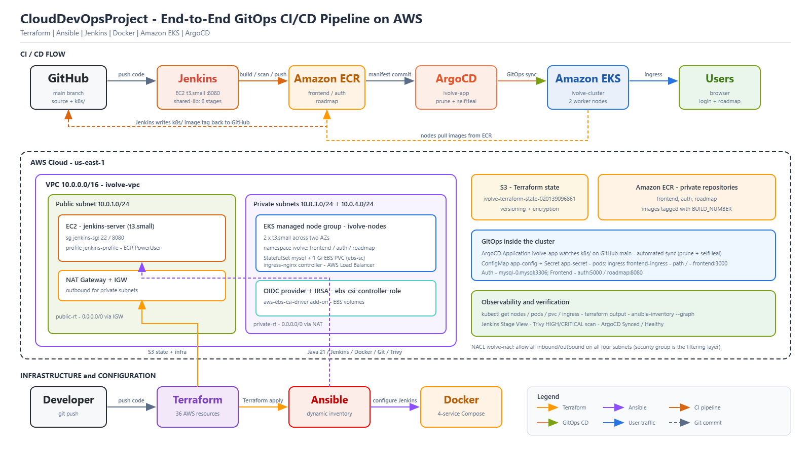
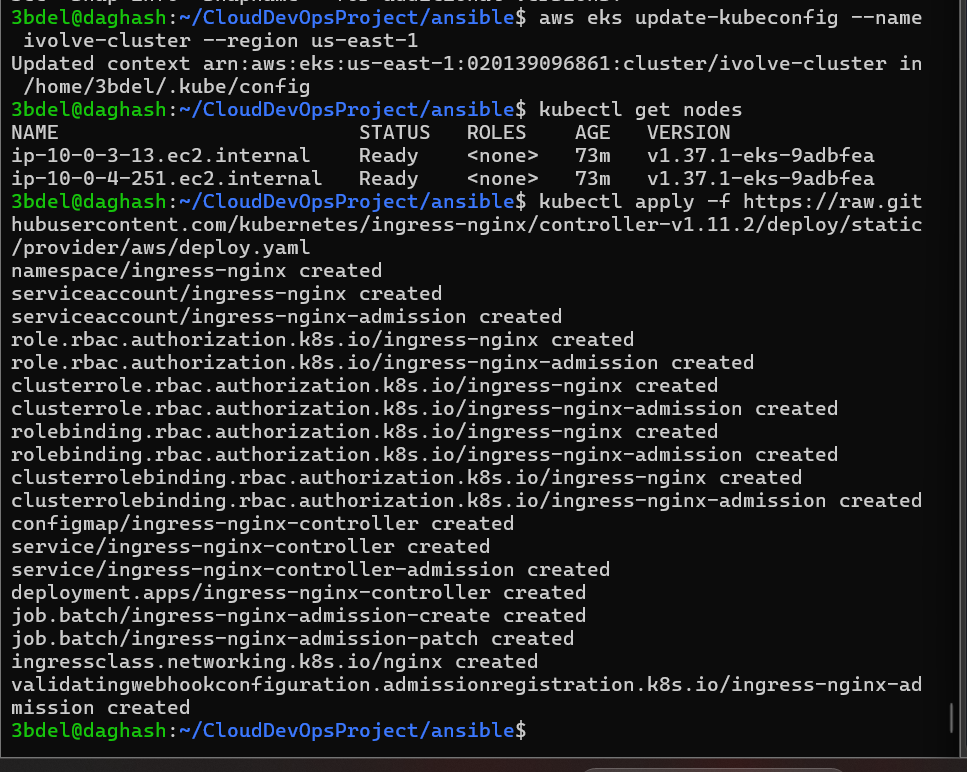
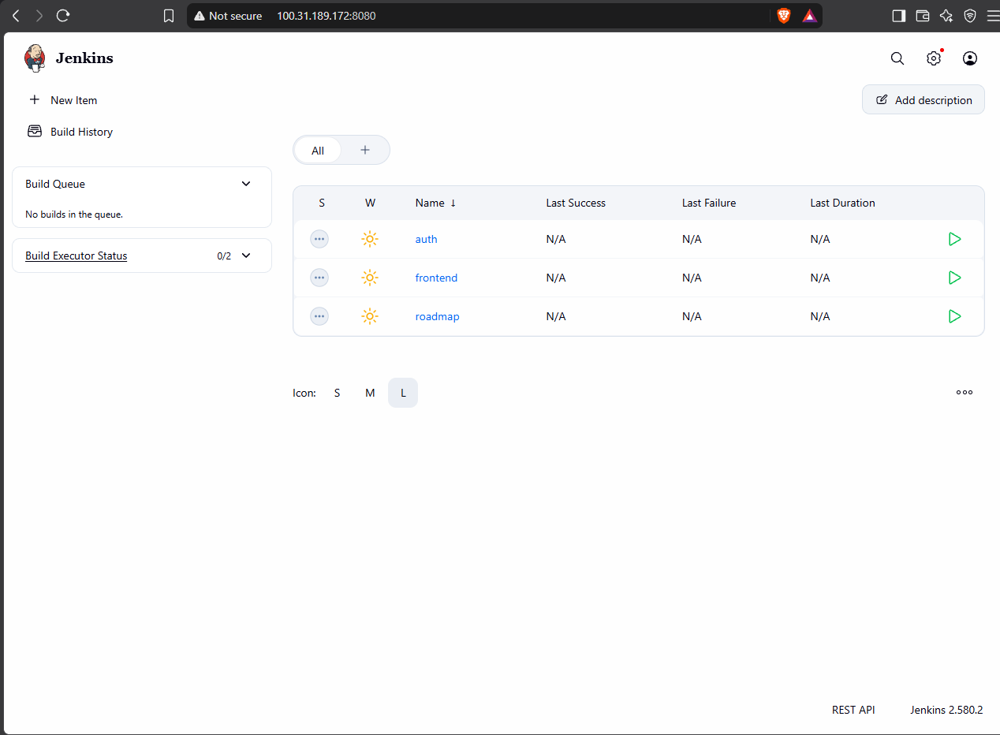
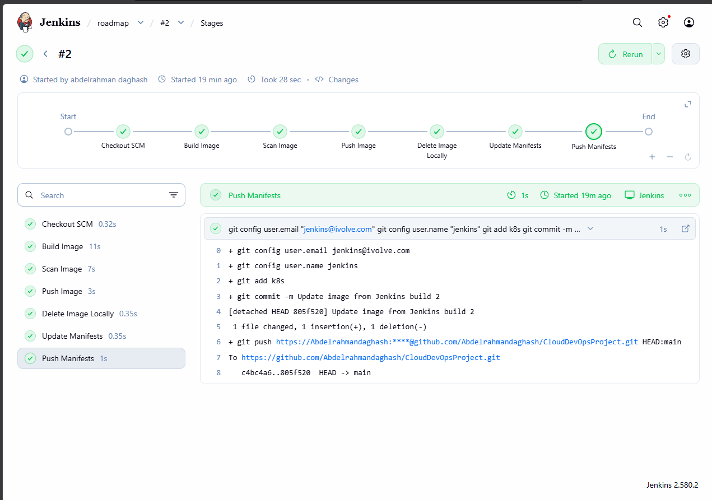
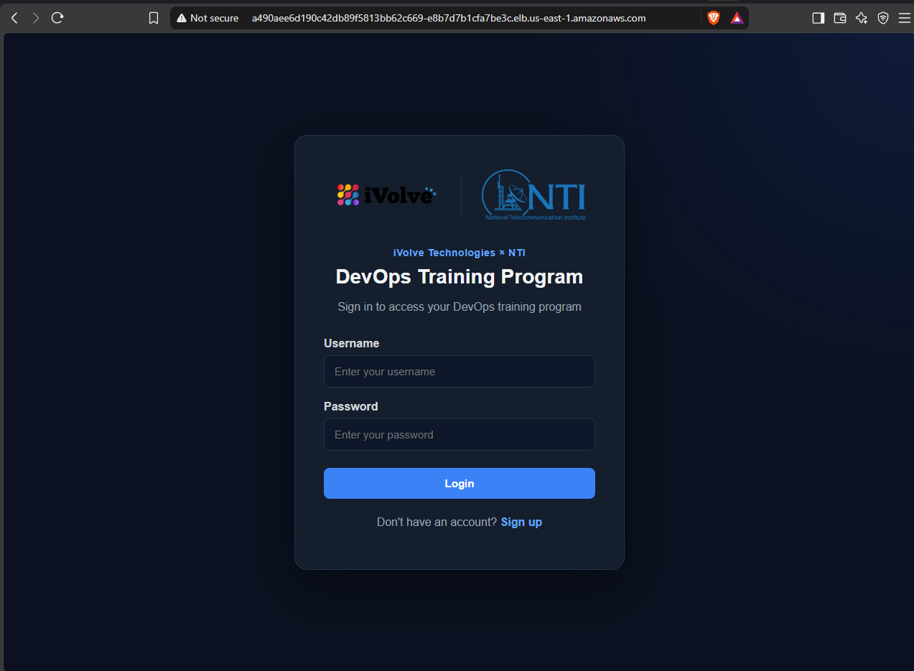
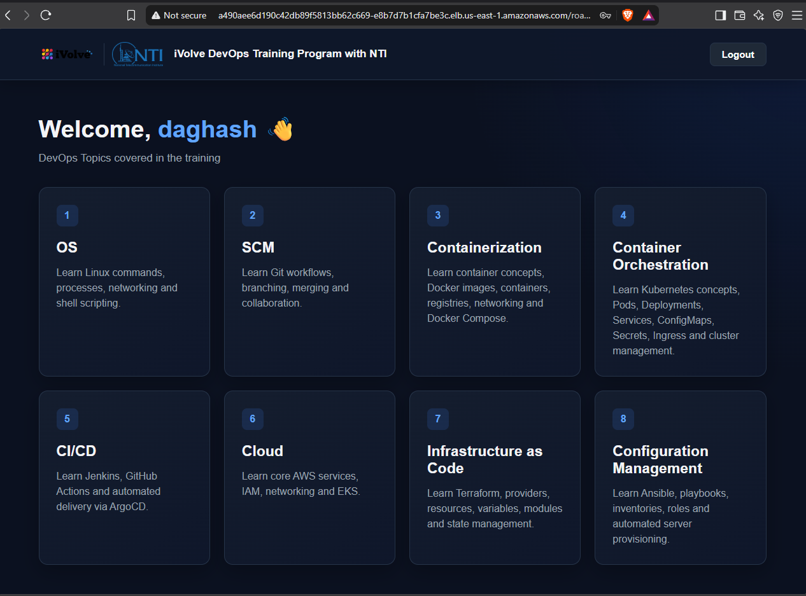

# 🌐 End-to-End GitOps CI/CD Pipeline on AWS

A comprehensive end-to-end CI/CD infrastructure for the **iVolve DevOps training platform**. This project leverages **Terraform** for AWS infrastructure provisioning, **Ansible** for automated configuration management, **Docker** for containerization, **Jenkins** for continuous integration, **Trivy** for image scanning, and **ArgoCD** for GitOps-based deployment to **Amazon EKS**.

---

## Project Architecture



> Editable source: [project-architecture.svg](docs/images/project-architecture.svg) · Detailed diagrams: [docs/architecture.md](docs/architecture.md)

---

## 🏗️ Architecture Overview

### 1. ☁️ AWS Infrastructure (Terraform Provisioned)

- **VPC `10.0.0.0/16` (`ivolve-vpc`)** with 2 public and 2 private subnets across two availability zones
- **Internet Gateway** + **NAT Gateway** for public ingress and private-subnet outbound access
- **Network ACL `ivolve-nacl`** applied to all four subnets; security group `jenkins-sg` allows SSH (22) and Jenkins (8080)
- **EC2 instance (Jenkins master)**: `t3.small`, Ubuntu 22.04, 20 GB disk, IAM instance profile for ECR push
- **Amazon EKS (`ivolve-cluster`)**: managed control plane + managed node group `ivolve-nodes` with two `t3.small` workers in private subnets
- **OIDC provider + IRSA role `ebs-csi-controller-role`** for the `aws-ebs-csi-driver` add-on and EBS volumes
- **Amazon ECR** with three private repositories: `frontend`, `auth`, `roadmap`
- **S3** remote backend (`ivolve-terraform-state-020139096861`) for Terraform state with versioning and encryption

### 2. ⚙️ Configuration Management using Ansible

- **Dynamic Inventory** using the EC2 tag `Name=jenkins-server` (`amazon.aws.aws_ec2` plugin)
- **Role-Based Setup** for modular, idempotent configuration: `java → jenkins → tools`
- **Java 21** (`openjdk-21-jre`) — required by current Jenkins packages
- **Jenkins installation** with the 2026 signing key and `systemctl reset-failed` to clear start-limit state
- **Docker, Git, AWS CLI and Trivy** installed across the CI host; `jenkins` added to the `docker` group
- **SSH key-based communication** using the EC2 key pair referenced in `ansible.cfg`

### 3. 💻 Kubernetes Environment

- **EKS Cluster** (managed by AWS): 1 control plane + 2 worker nodes
- **Namespace `ivolve`** hosting all application resources
- **Three Deployments** (`frontend`, `auth`, `roadmap`) and three ClusterIP Services (3000 / 5000 / 8080)
- **StatefulSet `mysql`** with a headless Service, stable DNS `mysql-0.mysql`, and a 1 Gi EBS-backed PVC (`ebs-sc`)
- **ConfigMap `app-config` + Secret `app-secret`** injected through `envFrom`
- **Ingress `frontend-ingress`** (class `nginx`) exposing the frontend through one AWS Load Balancer

### 4. 🔁 ArgoCD (GitOps Deployment)

- **Application Controller**, **Repository Server** and **GitOps Engine** from the official install manifest
- **Application `ivolve-app`** watches `path: k8s` on branch `main`
- **Automated sync** with `prune: true` and `selfHeal: true`
- Jenkins never accesses the cluster — it only commits manifest changes to GitHub

### 5. ⚙️ CI/CD Pipeline Flow

1. **Code push** to GitHub; the user clicks **Build Now** on `frontend`, `auth` or `roadmap`
2. **Jenkins** clones the `Jenkinsfile` and the `shared-lib` library (`vars/`)
3. **Build Image** → `docker build -t <ECR>/<service>:<BUILD_NUMBER> <folder>`
4. **Scan Image** → `trivy image --severity HIGH,CRITICAL <image>`
5. **Push Image** → ECR login via instance role, then `docker push`
6. **Delete Image Locally** → `docker rmi` to keep the CI host clean
7. **Update Manifests** → `sed` replaces the `image:` line in `k8s/<service>-deployment.yaml`
8. **Push Manifests** → commit with credential `github-creds`, push `HEAD:main`
9. **ArgoCD** detects the new commit, syncs EKS automatically
10. **Application** is deployed/updated with zero manual `kubectl apply`

---

## ✅ Prerequisites

- AWS account with permissions to create VPC, EC2, IAM, EKS, ECR and S3 resources
- Docker + Docker Compose, Terraform, AWS CLI v2, kubectl, Ansible + `amazon.aws`, Python 3 + `boto3`
- An EC2 key pair and an S3 bucket for the Terraform backend
- A GitHub Personal Access Token with `repo` scope for the Jenkins credential `github-creds`

```bash
git --version
docker --version && docker compose version
terraform version
aws --version
kubectl version --client
ansible --version
pip install boto3
ansible-galaxy collection install amazon.aws
aws configure
aws sts get-caller-identity
```

---

## 📁 Project Structure

```bash
.
├── README.md                 # Main documentation file (this file)
├── docker-compose.yml        # Local full stack: db + auth + roadmap + frontend
├── app/                      # Microservice source code (frontend, auth, roadmap)
├── terraform/                # Terraform modules & scripts (network, server, eks, ecr)
├── ansible/                  # Ansible roles, playbook and dynamic inventory
├── jenkins/                  # One Jenkinsfile per microservice
├── vars/                     # Jenkins shared library (6 Groovy steps)
├── k8s/                      # 13 Kubernetes manifests
├── argocd/                   # ArgoCD Application manifest
├── Screenshots/              # 16 numbered evidence captures
└── docs/
    ├── architecture.md       # Deep-dive diagrams and rationale
    ├── troubleshooting.md    # 25 documented problems and fixes
    ├── compose.md            # Docker Compose reference
    └── images/               # Screenshot manifest + architecture diagram
```

---

## 🧱 Project Components

### 🚀 Terraform (Infrastructure as Code)

Automates provisioning of the VPC, subnets, IGW/NAT, NACL, Jenkins EC2 + IAM profile, EKS cluster and node group, OIDC/IRSA, EBS CSI add-on, and three ECR repositories. State is kept in S3.

📄 [Terraform README →](terraform/README.md)

### ⚙️ Ansible (Configuration Management)

Configures the Jenkins EC2 using a dynamic inventory; installs Java 21, Jenkins, Docker, Git, AWS CLI and Trivy through three roles.

📄 [Ansible README →](ansible/README.md)

### 🛠️ Jenkins (CI/CD Pipeline)

Three pipelines built from a shared library with six stages: build, scan, push, delete locally, update manifests, push manifests.

📄 [Jenkins README →](jenkins/README.md) · [Shared library →](vars/README.md)

### 🐳 Docker (Application Containerization)

Four-service Compose stack for local development plus production-ready Dockerfiles for every microservice.

📄 [App README →](app/README.md) · [Compose reference →](docs/compose.md)

### ☸️ Kubernetes (Container Orchestration)

Namespaces, Deployments, Services, StatefulSet, headless Service, StorageClass, ConfigMap, Secret and Ingress — the GitOps source of truth.

📄 [Kubernetes README →](k8s/README.md)

### 🚀 ArgoCD (GitOps Continuous Deployment)

Watches `k8s/` on GitHub and deploys changes to EKS with prune and self-heal enabled.

📄 [ArgoCD README →](argocd/README.md)

---

## 🚀 Step-by-Step Deployment

### 1. GitHub Repository Setup

```bash
git clone https://github.com/<YOUR_USER>/CloudDevOpsProject.git
cd CloudDevOpsProject
git branch -M main
git add .
git commit -m "Initial commit: full DevOps pipeline"
git push -u origin main
```

Replace the example AWS account id, GitHub username, bucket name and repo URL in `terraform/backend.tf`, `k8s/*-deployment.yaml`, `jenkins/*/Jenkinsfile` and `argocd/application.yaml`.

### 2. Docker — Local Container Stack

```bash
docker compose config
docker compose up --build
docker compose ps
curl http://localhost:5000/health
curl http://localhost:8080/api/roadmap
curl http://localhost/
docker compose down
```

### 3. Terraform — AWS Infrastructure

```bash
cd terraform
terraform fmt -check -recursive
terraform init
terraform validate
terraform plan -var key_name=<KEY_PAIR>
terraform apply -var key_name=<KEY_PAIR>
terraform output jenkins_public_ip
terraform output ecr_urls
terraform output eks_cluster_name
```


### 4. Ansible — Configure the Jenkins Server

```bash
pip install boto3
ansible-galaxy collection install amazon.aws
cd ansible
ansible-playbook --syntax-check -i 'localhost,' playbook.yml
ansible-inventory --graph
ansible-playbook playbook.yml
ssh -i ~/ivolve-key.pem ubuntu@<JENKINS_PUBLIC_IP> \
  "sudo cat /var/lib/jenkins/secrets/initialAdminPassword"
```


### 5. Kubernetes — Manifests and Exposure

```bash
aws eks update-kubeconfig --name ivolve-cluster --region us-east-1
kubectl get nodes
kubectl apply -f https://raw.githubusercontent.com/kubernetes/ingress-nginx/controller-v1.11.2/deploy/static/provider/aws/deploy.yaml
kubectl get pods -n ingress-nginx
kubectl apply -f k8s/
kubectl get all,pvc,ingress -n ivolve
```




### 6. Jenkins CI — Pipelines and Shared Library

1. Finish the setup wizard; log in with `admin` and the password from step 4.
2. Add credential ID `github-creds` (*Username with password*, PAT with `repo` scope).
3. Register the global pipeline library `shared-lib` from this repository, branch `main`.
4. Create three *Pipeline script from SCM* jobs with script paths `jenkins/frontend/Jenkinsfile`, `jenkins/auth/Jenkinsfile`, `jenkins/roadmap/Jenkinsfile`.
5. Click **Build Now** on all three jobs.






### 7. ArgoCD — GitOps Delivery

```bash
kubectl create namespace argocd
kubectl apply -n argocd -f https://raw.githubusercontent.com/argoproj/argo-cd/stable/manifests/install.yaml
kubectl apply -f argocd/application.yaml
kubectl get application ivolve-app -n argocd
kubectl port-forward svc/argocd-server -n argocd 8081:443
# second terminal — never paste this password into docs or tickets:

kubectl -n argocd get secret argocd-initial-admin-secret \
  -o jsonpath='{.data.password}' | base64 -d; echo
```

Open `https://localhost:8081` (user `admin`). Expected: `Synced` and `Healthy`.


### 8. Application Access




---

## ✅ Verification

| Layer | Command | Expected |
|---|---|---|
| Compose | `docker compose ps` | `db` healthy, 3 services running |
| Terraform | `terraform validate` | Configuration valid |
| Ansible | `ansible-inventory --graph` | `jenkins-server` discovered |
| Jenkins | Dashboard | Three jobs green, six stages each |
| ECR | `aws ecr list-images --repository-name frontend` | Build-number tags |
| EKS | `kubectl get nodes` | 2 nodes `Ready` |
| Workloads | `kubectl get pods -n ivolve` | 4 pods `Running` |
| Storage | `kubectl get pvc -n ivolve` | `data-mysql-0` `Bound` |
| Ingress | `kubectl get ingress -n ivolve` | Address assigned |
| GitOps | `kubectl get application ivolve-app -n argocd` | `Synced`, `Healthy` |
| App | open ingress address | Login → roadmap with 8 cards |

---

## 🔐 Security Notes

| Finding | Where | Recommendation |
|---|---|---|
| Committed DB passwords | `k8s/secret.yaml` | Replace with `<PLACEHOLDER>` and use Sealed/External Secrets |
| Hard-coded dev credentials | `docker-compose.yml` | Move to an untracked `.env` file |
| Jenkins ports open to `0.0.0.0/0` | `terraform/modules/server/main.tf` | Restrict to your IP or place behind a VPN |
| NACL allows all traffic | `terraform/modules/network/main.tf` | Add explicit CIDR rules |
| Ingress has no TLS | `k8s/ingress.yaml` | Add cert-manager + certificate |
| Trivy reports but does not gate | `vars/scanImage.groovy` | Add `--exit-code 1` after a baseline |
| PAT in `git push` URL | `vars/pushManifests.groovy` | Use a credential helper or deploy key |
| `SESSION_SECRET` not injected | `k8s/frontend-deployment.yaml` | Add to Secret + `secretRef` |
| App uses MySQL root | `k8s/configmap.yaml` | Create a least-privilege user |
| `host_key_checking = False` | `ansible/ansible.cfg` | Enable or prepopulate `known_hosts` |
| Unpinned ArgoCD manifest | step 7 | Pin to a versioned release |
| `force_delete = true` on ECR | `terraform/modules/ecr/main.tf` | Remove in production |
| No pod resource limits | Deployments / StatefulSet | Add requests/limits |
| Account id + GitHub user hard-coded | several files | Parameterise before sharing |

> No real secret values are reproduced in this documentation — only key names and placeholders.

---

## 💰 Cost Awareness & Cleanup

Costs come from the EKS control plane, three `t3.small` EC2 instances (2 nodes + Jenkins), the NAT Gateway, the Load Balancer, EBS volumes, ECR storage and the S3 bucket.

```bash
kubectl delete ingress --all -n ivolve
kubectl delete -f argocd/application.yaml
terraform -chdir=terraform destroy -var key_name=<KEY_PAIR>
```

The S3 bucket and EC2 key pair are created outside Terraform and must be removed manually if no longer needed.

---

## 🧰 Troubleshooting & Lessons Learned

- Full Fixes: [docs/troubleshooting.md](docs/troubleshooting.md) — 25 documented problems
- Jenkins 2026 key rotation and `NO_PUBKEY 7198F4B714ABFC68` — handled in `ansible/roles/jenkins`
- Java 21 minimum version — handled in `ansible/roles/java`
- `StartLimitBurst` latch — `systemctl reset-failed jenkins`
- MySQL `lost+found` error — `subPath: mysql` in the StatefulSet
- EBS pod IAM — OIDC + IRSA role for `ebs-csi-controller-sa`
- Dynamic Ansible inventory — EC2 tag `Name=jenkins-server`
- GitOps boundary — Jenkins commits; ArgoCD applies

📄 [Architecture deep dive →](docs/architecture.md) · [Screenshot manifest →](docs/images/README.md)

---

## 🔮 Future Improvements

Prometheus + Grafana · cert-manager TLS · Helm charts · Sealed Secrets · Trivy hard gate · Node autoscaling and resource limits · MySQL backups · GitHub webhook to trigger Jenkins · Version pinning · Schedule stack shutdown outside working hours.

---

## 👨‍💻 Author

**Abdelrahman Daghash**  
Cloud DevOps Engineer — NTI DevOps Training Program, iVolve Technologies

## 📬 Contact

- 🐙 [GitHub](https://github.com/Abdelrahmandaghash)
- 📧 3bdelrahmandaghash@gmail.com
- 🔗 [Project repository](https://github.com/Abdelrahmandaghash/CloudDevOpsProject)
