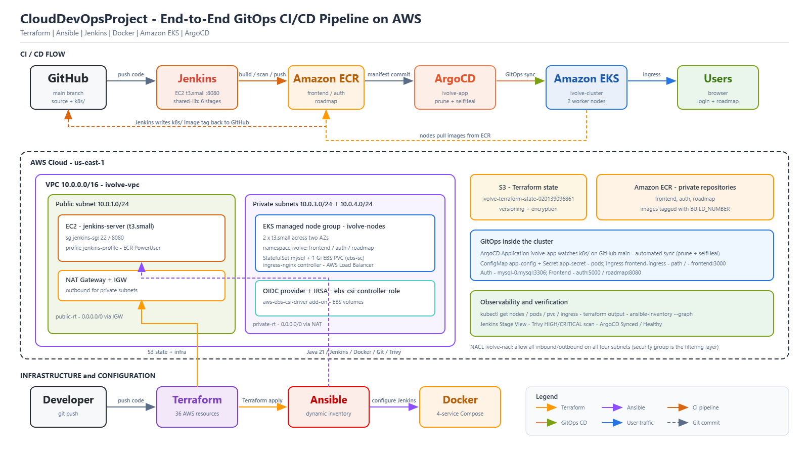

# ⚙️ Ansible — Jenkins Server Configuration

> Turns the fresh Jenkins EC2 into a CI server: Java 21, Jenkins, Docker, Git, AWS CLI and Trivy.
> The target host is discovered from AWS at run time. Full walkthrough:
> [section 4 of the root README](../README.md#4-ansible--configure-the-jenkins-server).



---

## 📁 Project Structure

| File | Purpose |
|------|---------|
| `ansible.cfg` | `inventory = aws_ec2.yml`, `remote_user = ubuntu`, `private_key_file = /home/3bdel/ivolve-key.pem`, `host_key_checking = False` |
| `aws_ec2.yml` | Plugin `amazon.aws.aws_ec2`, region `us-east-1`, filters `tag:Name=jenkins-server` + `instance-state-name=running`, hostname = public IP |
| `playbook.yml` | One play, `hosts: all`, `become: true`, roles in order `java → jenkins → tools` |
| [roles/](roles/README.md) | [java](roles/java/README.md) · [jenkins](roles/jenkins/README.md) · [tools](roles/tools/README.md) |

---

## ✅ Inputs

| Input | Where | Notes |
|---|---|---|
| AWS credentials | `aws configure` / environment / instance role | Need `ec2:DescribeInstances` for the inventory |
| `boto3` | control node | `pip install boto3` |
| Collection | control node | `ansible-galaxy collection install amazon.aws` |
| Private key | `ansible.cfg` → `private_key_file` | Change the hard-coded path to your own PEM; `chmod 400` |
| EC2 tag | Terraform sets `Name=jenkins-server` | Inventory filter matches it exactly |

---

## 📤 Outputs

| Result | How to see it |
|---|---|
| Running services `jenkins` and `docker` | `systemctl is-active jenkins docker` on the host |
| `PLAY RECAP` with `failed=0` | Playbook console output |
| Jenkins UI on port 8080 | `http://<JENKINS_PUBLIC_IP>:8080` |
| `jenkins` user in the `docker` group | `id jenkins` on the host |

---

## 🚀 How to Run

```bash
ansible-playbook --syntax-check -i 'localhost,' playbook.yml   # read-only check
ansible-inventory --graph
ansible-playbook playbook.yml
ssh -i ~/ivolve-key.pem ubuntu@<JENKINS_PUBLIC_IP> \
  "sudo cat /var/lib/jenkins/secrets/initialAdminPassword"
```

---

## 🔗 Related

- [Root README](../README.md)
- [Terraform server module](../terraform/modules/server/README.md)
- [Jenkins pipelines](../jenkins/README.md)

---

## 👨‍💻 Author

**Abdelrahman Daghash**  
Cloud DevOps Engineer — NTI DevOps Training Program, iVolve Technologies

## 📬 Contact

- 🐙 [GitHub](https://github.com/Abdelrahmandaghash)
- 📧 3bdelrahmandaghash@gmail.com
- 🔗 [Project repository](https://github.com/Abdelrahmandaghash/CloudDevOpsProject)
