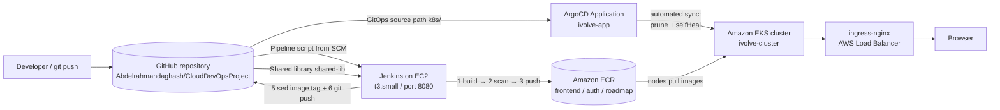
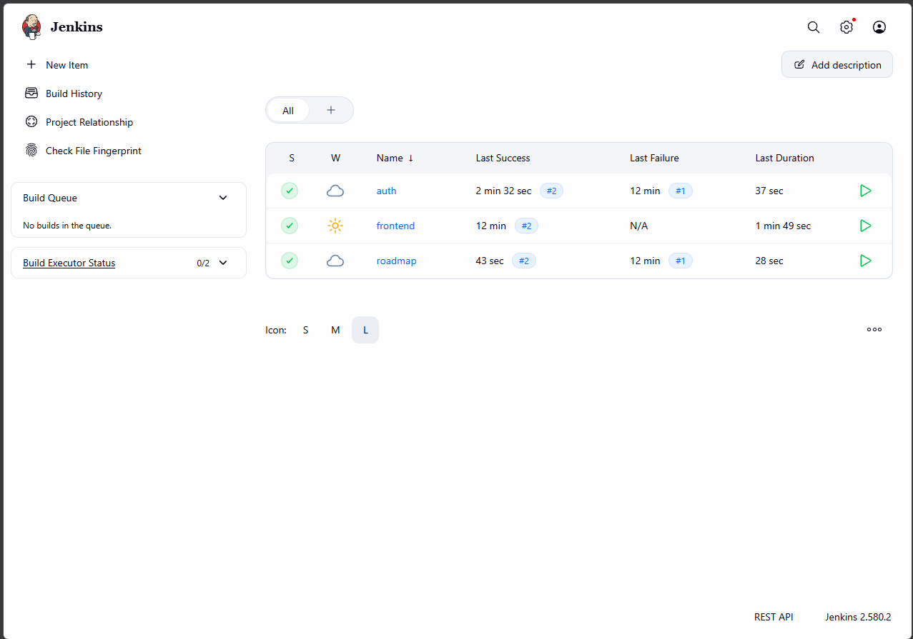
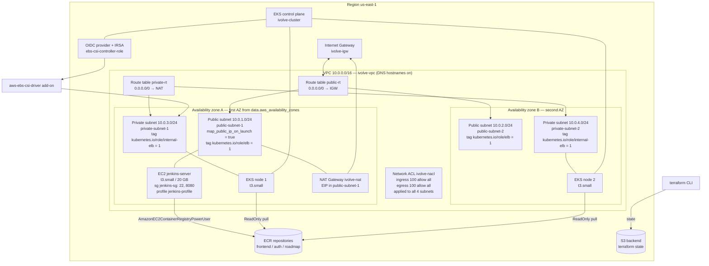
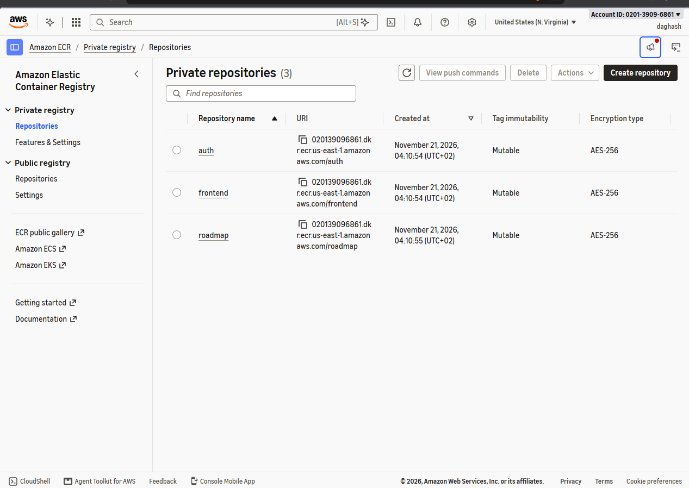
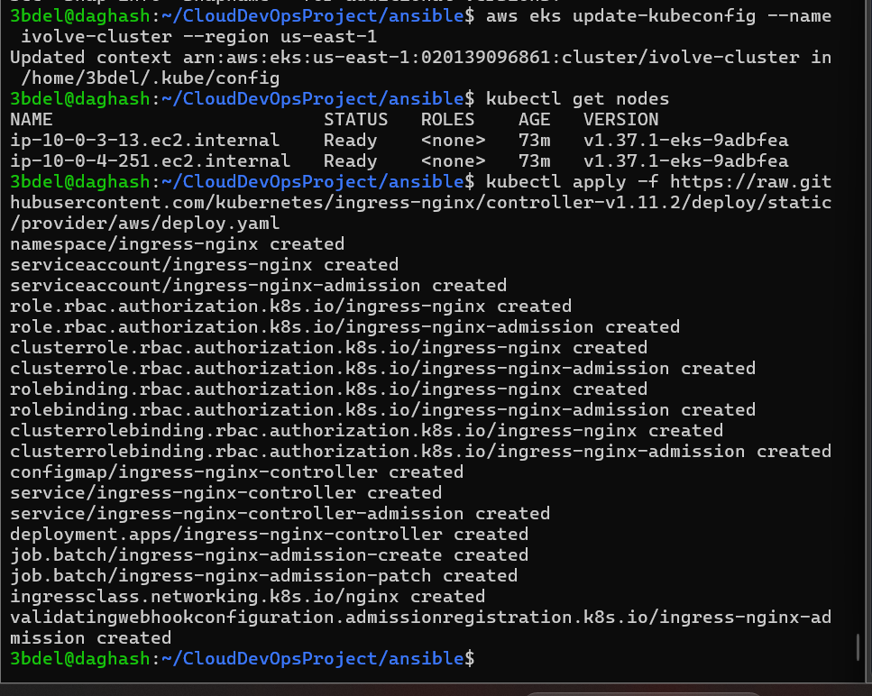
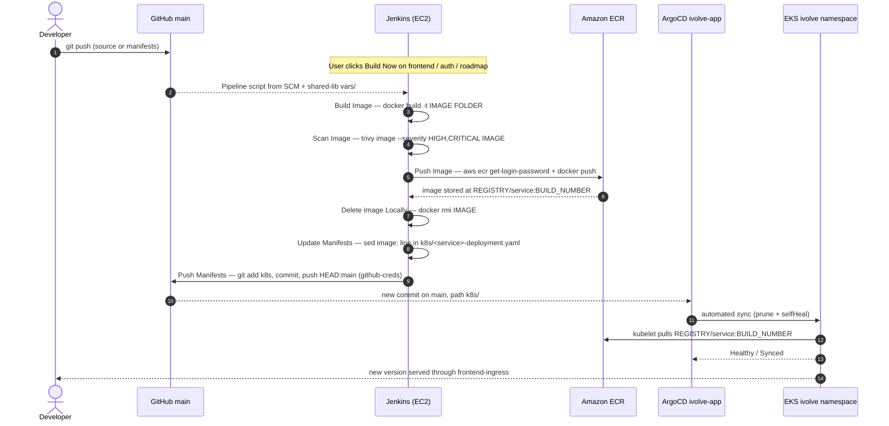
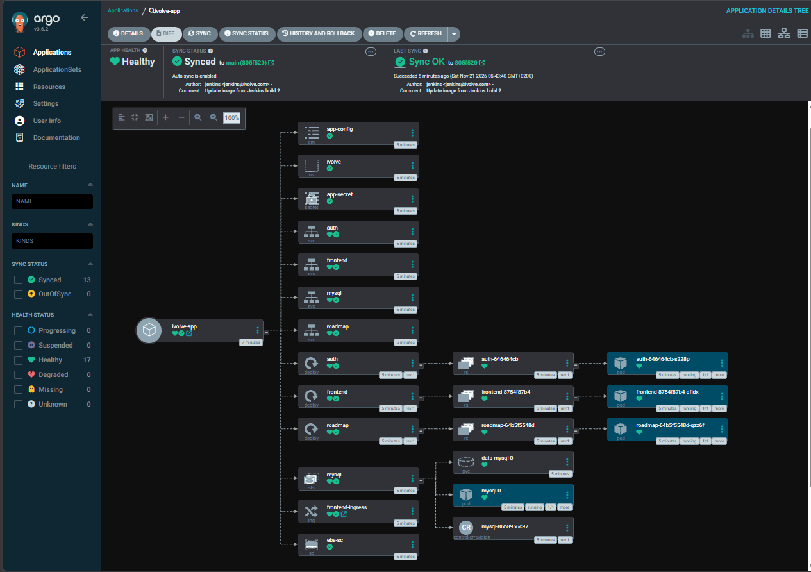
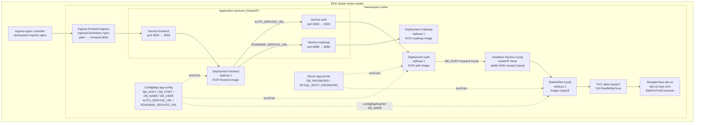
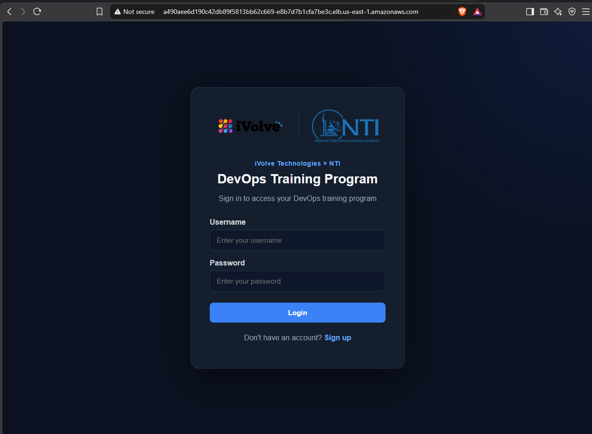
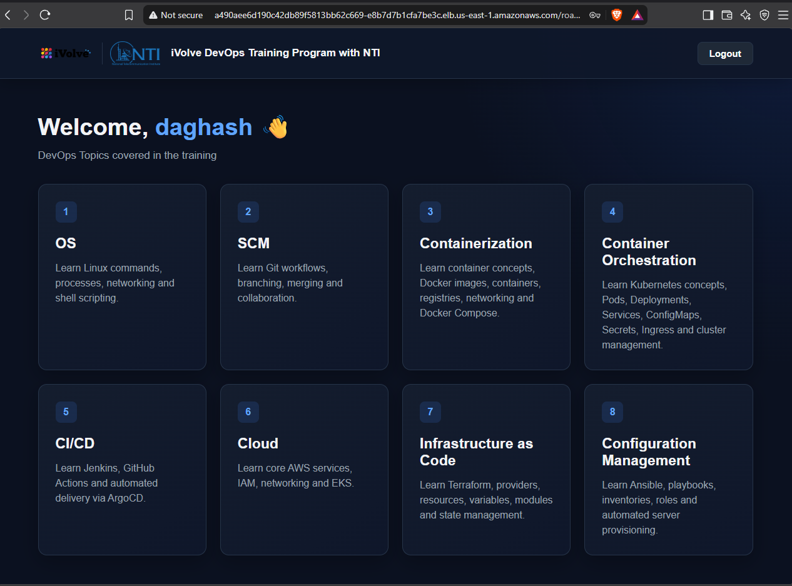

# Architecture deep dive

> Companion to the [root README](../README.md). This document explains **how the pieces fit
> together and why each one was chosen**, using only names and values that exist in this repository.

---

## Contents

- [1. System context](#1-system-context)
- [2. AWS network](#2-aws-network)
- [3. CI/CD sequence](#3-cicd-sequence)
- [4. Kubernetes workload layout](#4-kubernetes-workload-layout)
- [5. Component rationale](#5-component-rationale)
- [6. Data and identity flow](#6-data-and-identity-flow)
- [7. Failure domains](#7-failure-domains)
- [8. Related evidence](#8-related-evidence)

---

## 1. System context

**Reading the diagram**

1. GitHub is the only place where two things are stored: the application source **and** the desired
   Kubernetes state (`k8s/`).
2. Jenkins reads both the pipeline definitions (`jenkins/*/Jenkinsfile`) and the reusable steps
   (`vars/`). It never talks to the EKS API.
3. ArgoCD reads `k8s/` from GitHub and is the only component that applies manifests to EKS.
4. ECR is the hand-off between CI and CD: Jenkins writes images, EKS nodes read them.

---

## 2. AWS network

Terraform builds one VPC, two public and two private subnets in the **first two available AZs**, one
Internet Gateway, one NAT Gateway, a NACL applied to all four subnets, a Jenkins EC2 in a public
subnet, and an EKS cluster whose two `t3.small` nodes live in the private subnets.

### Routing rules

| Subnet type | Route table | Destination | Target | Reason |
|---|---|---|---|---|
| Public (×2) | `public-rt` | `0.0.0.0/0` | `ivolve-igw` | Jenkins needs inbound SSH/8080 and outbound package downloads |
| Private (×2) | `private-rt` | `0.0.0.0/0` | `ivolve-nat` | EKS nodes pull images and reach AWS APIs without being internet-addressable |

### Security group — `jenkins-sg`

| Direction | Rule | Protocol | Port | Source / destination | Purpose |
|---|---|---|---|---|---|
| Ingress | 1 | tcp | 22 | `0.0.0.0/0` | SSH for Ansible and administration |
| Ingress | 2 | tcp | 8080 | `0.0.0.0/0` | Jenkins web UI |
| Egress | 1 | all | all | `0.0.0.0/0` | apt, Docker Hub/ECR, AWS APIs |

### Network ACL — `ivolve-nacl`

| Direction | Rule number | Protocol | Port | CIDR | Action |
|---|---:|---|---|---|---|
| Ingress | 100 | `-1` (all) | 0–65535 | `0.0.0.0/0` | allow |
| Egress | 100 | `-1` (all) | 0–65535 | `0.0.0.0/0` | allow |

> The NACL is deliberately permissive; the declarative filtering is done by `jenkins-sg`. See the
> [Security considerations](../README.md#11-security-considerations) section for the recommended
> hardening.

---

## 3. CI/CD sequence

**Why the manifest push is the boundary:** Jenkins does not need a kubeconfig. Its last action is an
ordinary Git commit. ArgoCD polls that Git path and performs the deployment. This is the defining
property of the GitOps design in this project.

---

## 4. Kubernetes workload layout

### Request path

1. The browser reaches the AWS Load Balancer created for `frontend-ingress`.
2. ingress-nginx matches path `/` and forwards to `frontend:3000`.
3. `/login` and `/signup` in the frontend call `http://auth:5000/api/auth/...`.
4. `/roadmap` in the frontend calls `http://roadmap:8080/api/roadmap`.
5. The auth service writes to `mysql-0.mysql:3306`; MySQL data lives on a 1 Gi EBS volume.
6. The session cookie is signed by `SESSION_SECRET`. The Deployment does not inject that variable,
   so the application uses its built-in default — see
   [Security considerations](../README.md#11-security-considerations).

---

## 5. Component rationale

| Component | What it does here | Why it was chosen |
|---|---|---|
| Docker + Dockerfiles | Packages each microservice into an immutable image | One artifact for local Compose runs and for EKS; the Java service is multi-stage so Maven never ships in the runtime image |
| Docker Compose | Runs `db`, `auth-service`, `roadmap-service`, `frontend` locally | Health-gated startup (`db` healthy before `auth-service`) reproduces the cluster's dependency order without Kubernetes |
| Terraform (S3 backend) | Creates 36 AWS resources and keeps state in S3 | One command creates/recreates the whole environment; S3 state can be shared and versioned |
| Modules `network`, `server`, `eks`, `ecr` | Split the infrastructure into composable units | Each unit has clear inputs/outputs, which makes `main.tf` read like a blueprint |
| EKS managed node group | Runs the four workloads on 2 × `t3.small` | Managed control plane; fixed size (`min = max = desired = 2`) keeps cost predictable |
| IRSA + EBS CSI add-on | Lets the CSI controller create EBS volumes without node credentials | Pods cannot use the node IAM role; IRSA is the AWS-native way to grant a service account permissions |
| Ansible dynamic inventory | Finds the EC2 by tag `Name=jenkins-server` | The public IP changes after every `apply`; a static inventory would go stale |
| Ansible roles `java`, `jenkins`, `tools` | Configure the CI host declaratively | Idempotent, readable, and reusable; the Jenkins role also clears systemd's failed-start latch |
| Jenkins + shared library | Six identical stages for each of the three services | `vars/` keeps the logic in one place; the image tag is `BUILD_NUMBER`, so every deployment maps to a build |
| Trivy | Reports HIGH/CRITICAL findings before push | Shifts vulnerability discovery left in the pipeline |
| ECR | Private registry for the three images | Native IAM integration with both the Jenkins instance role and the EKS node role |
| ArgoCD `Application` | Watches `k8s/` on `main` and syncs with `prune` + `selfHeal` | Git becomes the audit trail; drift is corrected automatically and Jenkins needs no cluster credentials |
| ingress-nginx | Exposes the frontend through one AWS Load Balancer | A single public entry point for the whole application |
| StatefulSet + headless Service | Gives MySQL a stable name (`mysql-0.mysql`) and disk | Database identity and storage must survive pod restarts |

---

## 6. Data and identity flow

| Flow | Mechanism | Source of the value |
|---|---|---|
| Terraform state | S3 backend `ivolve-terraform-state-020139096861`, key `cloud-devops-project/terraform.tfstate` | `terraform/backend.tf` |
| Ansible finds Jenkins | `amazon.aws.aws_ec2` plugin, filter `tag:Name=jenkins-server`, `instance-state-name=running` | `ansible/aws_ec2.yml` |
| Ansible SSH key | `private_key_file = /home/3bdel/ivolve-key.pem` | `ansible/ansible.cfg` (change to your own path) |
| Jenkins pushes to ECR | Instance profile `jenkins-profile` → `jenkins-role` → `AmazonEC2ContainerRegistryPowerUser` | `terraform/modules/server/main.tf` |
| EKS nodes pull from ECR | Node role policies including `AmazonEC2ContainerRegistryReadOnly` | `terraform/modules/eks/main.tf` |
| EBS CSI creates disks | OIDC provider → IRSA role `ebs-csi-controller-role` → SA `kube-system/ebs-csi-controller-sa` | `terraform/modules/eks/main.tf` |
| Jenkins pushes manifests | Credential `github-creds` (username + PAT with `repo` scope) | `vars/pushManifests.groovy` |
| Pods get configuration | `envFrom` ConfigMap `app-config` and Secret `app-secret` | `k8s/*-deployment.yaml`, `k8s/mysql-statefulset.yaml` |
| Users log in | Frontend → auth → bcrypt hash in MySQL `users` table | `app/auth-service/app.py` |

---

## 7. Failure domains

| If this fails… | Effect | Recovery |
|---|---|---|
| NAT Gateway | EKS nodes cannot pull new images or reach AWS APIs | Recreate the NAT EIP/Gateway via Terraform; existing pods keep running |
| Jenkins EC2 | No new builds or manifest updates | Re-run Terraform to replace the instance, then re-run Ansible; dynamic inventory finds the new IP |
| ECR | New deployments cannot pull images; already-cached images may still run | Recreate repositories via Terraform and re-run all three pipelines |
| EBS CSI add-on / IRSA | MySQL PVC stays `Pending` | Verify the add-on and the IRSA trust policy; recreate via Terraform |
| ArgoCD | Manual changes are no longer reverted; new image tags are not deployed | Restore the `ivolve-app` Application; it will reconcile `k8s/` on the next sync |
| ingress-nginx controller | Ingress address stops serving | Reapply the controller manifest from the root README's Step 6 |

---

## 8. Related evidence

- [Screenshot gallery index](../Screenshots/README.md)
- [Screenshot capture manifest](images/README.md)
- [Step-by-step build guide](../README.md#step-by-step-deployment-guide)
- [Troubleshooting](troubleshooting.md)
