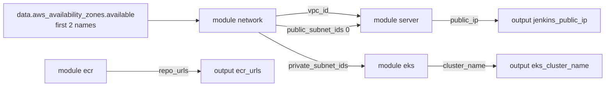

# `terraform/modules/` — reusable infrastructure modules

> Four modules composed by [`terraform/main.tf`](../main.tf). Each has `variables.tf`, `main.tf` and
> `outputs.tf`.

| Module | Purpose | Inputs | Outputs |
|---|---|---|---|
| [network/](network/README.md) | VPC, 4 subnets, IGW, NAT, route tables, NACL | `vpc_cidr`, `azs`, `public_subnet_cidrs`, `private_subnet_cidrs` | `vpc_id`, `public_subnet_ids`, `private_subnet_ids` |
| [server/](server/README.md) | Jenkins EC2, security group, IAM profile | `vpc_id`, `subnet_id`, `key_name`, `instance_type` | `public_ip` |
| [eks/](eks/README.md) | EKS cluster, node group, OIDC, IRSA, EBS CSI | `cluster_name`, `private_subnet_ids` | `cluster_name` |
| [ecr/](ecr/README.md) | Three private repositories | `repo_names` | `repo_urls` |

## Composition



## How to run

You never run a module directly. From `terraform/`:

```bash
terraform init && terraform validate && terraform plan -var key_name=<KEY_PAIR>
```

## Related

- [terraform overview](../README.md)
- [Root deployment guide](../../README.md)
