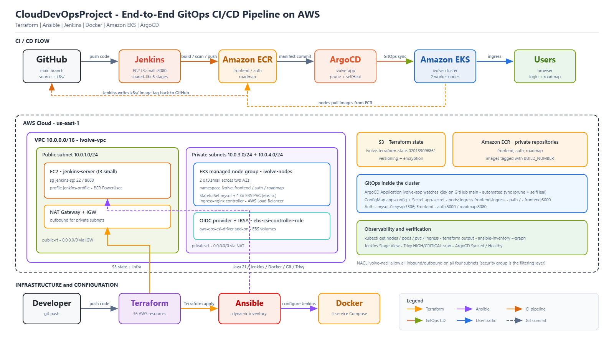

# 🧩 Jenkins Shared Library — Reusable Pipeline Steps

> Reusable pipeline steps shared by all three Jenkinsfiles. Register this repository as a global
> pipeline library named **`shared-lib`**; each file name becomes a callable step.

---

## 🧩 Functions

| File / function | Parameters | Command executed | Purpose |
|---|---|---|---|
| `buildImage.groovy` | `image`, `folder` | `docker build -t <image> <folder>` | Build the image from the service folder |
| `scanImage.groovy` | `image` | `trivy image --severity HIGH,CRITICAL <image>` | Report HIGH/CRITICAL findings |
| `pushImage.groovy` | `image`, `registry`, `region` | `aws ecr get-login-password … \| docker login …`; `docker push <image>` | Publish to ECR |
| `deleteImage.groovy` | `image` | `docker rmi <image>` | Free disk on the Jenkins host |
| `updateManifests.groovy` | `file`, `image` | `sed -i 's\|image: .*\|image: <image>\|' <file>` | Point the Deployment at the new tag |
| `pushManifests.groovy` | `githubRepo` | `git config …`; `git add k8s`; `git commit -m "Update image from Jenkins build ${BUILD_NUMBER}"`; `git push https://${GIT_USER}:${GIT_TOKEN}@<repo> HEAD:main` | Hand off to ArgoCD |

---

## Inputs / outputs

- **Inputs:** the parameters above, environment `BUILD_NUMBER`, credential ID `github-creds`, and the
  tools installed by the [Ansible `tools` role](../ansible/roles/tools/README.md).
- **Outputs:** one ECR image and one Git commit per pipeline run.

---

## 🔐 Authentication

`pushManifests.groovy` uses `withCredentials([usernamePassword(credentialsId: 'github-creds',
usernameVariable: 'GIT_USER', passwordVariable: 'GIT_TOKEN')])`. Credential ID must match exactly.
Commit identity is `jenkins / jenkins@ivolve.com`.

> **Security note:** the PAT is interpolated into the `git push` URL. Hide console output or move to
> a credential helper/SSH key in a production setup. See
> [Security considerations](../README.md).

---

## 🧪 How to Test

There are no unit tests for the library. Validate a change by running one Jenkins job and checking
that all six stages pass and a commit appears in `k8s/`.

---

## 🔗 Related

- [Jenkins pipelines](../jenkins/README.md)
- [Root README](../README.md)

---

## 👨‍💻 Author

**Abdelrahman Daghash**  
Cloud DevOps Engineer — NTI DevOps Training Program, iVolve Technologies

## 📬 Contact

- 🐙 [GitHub](https://github.com/Abdelrahmandaghash)
- 📧 3bdelrahmandaghash@gmail.com
- 🔗 [Project repository](https://github.com/Abdelrahmandaghash/CloudDevOpsProject)
